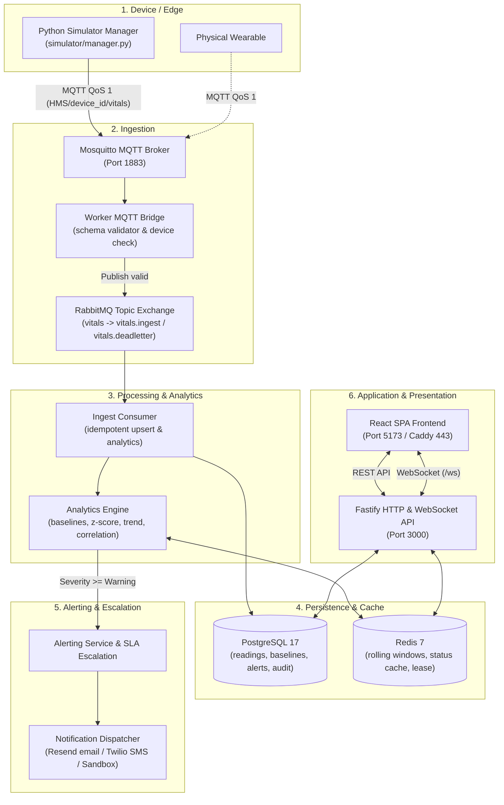
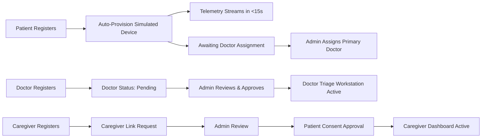

# VitalGuard

[](https://github.com/vitalguard/vitalguard/actions/workflows/ci.yml)
[](.nvmrc)
[](package.json)
[](simulator/requirements.txt)
[](https://opensource.org/licenses/MIT)

> [!WARNING]
> **Academic Project Disclaimer:** VitalGuard is an educational software engineering project developed for IT303 - Software Engineering. It is **not** a certified medical device and is **not** intended for clinical diagnosis, treatment decisions, or emergency medical monitoring.

VitalGuard is an end-to-end IoT patient health monitoring platform. Wearable devices (or the multi-patient simulator) publish continuous vital signs (Heart Rate, SpO2, Temperature, and Motion) over MQTT. A distributed processing pipeline ingests and validates the telemetry, calculates dynamic patient baselines and anomaly scores, classifies clinical severity (Normal, Watch, Warning, Critical), escalates alerts with simulated email/SMS dispatches, and delivers live updates to web dashboards via WebSockets.

---

## Table of Contents

- [Features](#features)
- [Architecture](#architecture)
- [Tech Stack](#tech-stack)
- [Repository Layout](#repository-layout)
- [Prerequisites](#prerequisites)
- [Quick Start (Local Development)](#quick-start-local-development)
  - [Demo Accounts](#demo-accounts)
  - [5-Minute Demo Walkthrough](#5-minute-demo-walkthrough)
- [Simulator Guide](#simulator-guide)
- [Running Tests & Quality Checks](#running-tests--quality-checks)
- [API Overview](#api-overview)
- [Data Model Overview](#data-model-overview)
- [Security & Privacy](#security--privacy)
- [Production Deployment](#production-deployment)
- [Troubleshooting](#troubleshooting)
- [Known Limitations & Future Work](#known-limitations--future-work)
- [Team and Work Division](#team-and-work-division)
- [Contributing](#contributing)
- [Course Framing & Authors](#course-framing--authors)

---

## Features

### Role-Specific Portals

- **Patient**: Real-time vital signs stream, live severity status badges, interactive history charts (24h / 7d / 30d range selection), pending clinical onboarding state, simulated-device indicator, and caregiver consent management ("who can see my data").
- **Caregiver**: Multi-patient roster with live vitals and open alert badges for consenting patients, plus caregiver link request workflows.
- **Doctor**: Self-registration with medical license and clinic affiliation, application status tracking, clinical triage workstation, patient detail inspection, vital-sign threshold overrides, weekly PDF report generation/download, and **availability self-management** (toggle Available/Unavailable with an optional note and optional return time; status persists across refresh and is shown in the top bar).
- **Administrator**: Dedicated 8-tab governance console (Overview, Doctor Requests, Institutions, Doctors, Patients, Caregiver Links, Users, Audit Log), doctor licensing approve/reject/suspend/reinstate, patient-to-doctor assignment and cross-institution transfers with **availability enforcement** (unavailable doctors are disabled in dropdowns; the API rejects them with HTTP 409 `DOCTOR_UNAVAILABLE`), overview counts for available/unavailable doctors, automatic availability-change notifications, emergency account suspension, audit trail inspection, notification center, and per-device simulation scenario injection (`normal`, `deteriorating`, `tachycardia`, etc.).

### System Capabilities

- **Ingestion Pipeline**: Mosquitto MQTT broker bridges into RabbitMQ topic exchange (`vitals`), enforces JSON schema validation, strips legacy payloads, verifies device registration against Redis/Postgres, and routes invalid messages to a dead-letter queue (`vitals.deadletter`).
- **Clinical Analytics**: Continuous sliding-window baselines (7-day mean and standard deviation cached in Redis, persisted in Postgres), z-score anomaly calculation, rate-of-change trend detection, and multi-vital correlation rules.
- **Alerting & Escalation**: Classifies telemetry into four severity tiers (**Normal**, **Watch**, **Warning**, **Critical**). Warning/Critical tiers create database alerts; Critical triggers sandboxed email/SMS notifications and an SLA escalation checker increments escalation levels if unacknowledged within deadlines.
- **Live Updates**: High-throughput Fastify WebSocket gateway (`GET /ws`) with Redis cache polling (500ms default) pushes changed patient statuses to connected browsers.
- **Edge Simulator**: Always-on Python service with dynamic REST discovery (`GET /internal/simulated-devices`), auto-provisioning for newly registered patients (<15s SLA), distinct resting baselines per patient, scenarios, and atomic Redis lease locking for high availability.

---

This repository is the source of truth for the VitalGuard platform.

## Architecture

### Data Path & System Layers



### Onboarding & Clinical Governance Flow



---

## Tech Stack

| Component          | Technology                                                       | Rationale                                                               |
| ------------------ | ---------------------------------------------------------------- | ----------------------------------------------------------------------- |
| **Frontend**       | React 19, TypeScript, Vite, Tailwind CSS, Recharts, Lucide Icons | Responsive clinical dashboards with client-side error isolation         |
| **Backend API**    | Node.js, Fastify, TypeScript, Drizzle ORM, Zod, Argon2id         | Low overhead, native schema validation, and high WebSocket concurrency  |
| **Worker Engine**  | Node.js, TypeScript, amqplib, mqtt.js, node-cron, PDFKit         | Reliable messaging, background analytics, and weekly PDF reporting      |
| **Edge Simulator** | Python 3.10+, paho-mqtt, jsonschema, pytest, ruff                | Autonomous multi-patient simulation with random-walk physiological math |
| **Datastores**     | PostgreSQL 17, Redis 7                                           | Relational ACID clinical history alongside low-latency sliding caches   |
| **Message Broker** | RabbitMQ 4 (AMQP), Eclipse Mosquitto 2.0 (MQTT)                  | Decoupled ingest with dead-lettering and pub/sub IoT gateway            |
| **Reverse Proxy**  | Caddy 2 (Alpine)                                                 | Single-command production TLS reverse proxy with HTTP/2 and HTTP/3      |

---

## Repository Layout

```text
VitalGuard/
├── apps/
│   ├── api/             # Fastify HTTP & WebSocket server (auth, governance, patients, devices)
│   ├── web/             # React SPA (patient, caregiver, doctor, and admin portals)
│   └── worker/          # Ingestion bridge, analytics engine, alert dispatcher, weekly reports
├── packages/
│   ├── config/          # Shared ESLint, Prettier, and TypeScript configurations
│   └── shared-types/    # Domain types, vital schemas, and API contracts
├── simulator/           # Multi-device Python simulator service, scenarios, and sensor models
├── schemas/             # Canonical JSON Schema for MQTT vital telemetry packets
├── infra/               # Docker Compose files (dev & prod), Caddyfile, and environment configs
├── docs/                # Architecture, verification reports, and production deployment guide
├── scripts/             # End-to-end verification, secret generation, and database utilities
└── CODEOWNERS           # Review assignment mapping three-teammate vertical ownership
```

---

## Prerequisites

- **Node.js**: `>= 24.0.0` (check via `node -v`; matches [`.nvmrc`](.nvmrc)).
- **pnpm**: `9.15.4` (`pnpm -v`). If `corepack enable` fails on Windows without Administrator rights, install directly: `npm install -g pnpm@9`.
- **Python**: `3.10+` (tested on 3.11 and 3.14). Virtual environments are placed in `.venv`.
- **Docker & Docker Compose**: Docker Desktop with Linux containers enabled.

> [!TIP]
> **Windows Port 5432 Conflicts:** If you have a local PostgreSQL service running natively on Windows, it will block Docker from binding port 5432. Stop it before running Docker:
>
> ```powershell
> Stop-Service postgresql* -Force
> ```

---

## Quick Start (Local Development)

Follow these steps in order to launch the full development stack.

### 1. Clone & Install Dependencies

```powershell
git clone https://github.com/vitalguard/vitalguard.git
cd VitalGuard
pnpm install
```

### 2. Configure Environment Files

**Windows (PowerShell):**

```powershell
Copy-Item infra/.env.example infra/.env
Copy-Item apps/api/.env.example apps/api/.env
Copy-Item apps/worker/.env.example apps/worker/.env
Copy-Item apps/web/.env.example apps/web/.env
Copy-Item simulator/.env.example simulator/.env
```

_(On macOS / Linux, substitute `cp` for `Copy-Item`)._

#### Key Environment Variables

| File               | Variable                          | Purpose                                 | Default / Requirement                      |
| ------------------ | --------------------------------- | --------------------------------------- | ------------------------------------------ |
| `apps/api/.env`    | `JWT_SECRET`                      | Secret for signing auth tokens          | Min 16 chars (random string)               |
| `apps/api/.env`    | `SIMULATOR_SERVICE_TOKEN`         | Bearer token for device discovery       | Must match `simulator/.env`                |
| `apps/api/.env`    | `AUTO_PROVISION_SIMULATED_DEVICE` | Auto-assigns IoT device on registration | `true`                                     |
| `apps/worker/.env` | `DATABASE_URL` / `REDIS_URL`      | Datastore connection strings            | Matches `infra/.env` defaults              |
| `simulator/.env`   | `SIMULATOR_SERVICE_TOKEN`         | Shared internal discovery token         | Must match `apps/api/.env`                 |
| _(Optional)_       | `RESEND_API_KEY` / `TWILIO_*`     | Real email/SMS dispatch                 | If omitted, worker logs to console sandbox |

### 3. Start Backing Infrastructure

```powershell
docker compose -f infra/docker-compose.yml up -d
```

Verify that Postgres (5432), Redis (6379), RabbitMQ (5672/15672), and Mosquitto (1883) are healthy:

```powershell
docker compose -f infra/docker-compose.yml ps
```

### 4. Run Migrations & Seed Database

```powershell
pnpm --filter @vitalguard/api db:migrate
pnpm --filter @vitalguard/api db:seed
```

### 5. Bootstrap the Administrator

```powershell
$env:INITIAL_ADMIN_EMAIL="admin-demo@vitalguard.local"
$env:INITIAL_ADMIN_PASSWORD="DemoAdmin!2026"
pnpm --filter @vitalguard/api db:bootstrap-admin
```

_(Clear `$env:INITIAL_ADMIN_PASSWORD` afterwards. The bootstrapped admin requires a password change upon first login)._

### 6. Start Application Services

Run each in a separate terminal:

- **Terminal 1 (Backend API - Port 3000):**
  ```powershell
  pnpm --filter @vitalguard/api dev
  ```
- **Terminal 2 (Worker Processing Engine):**
  ```powershell
  pnpm --filter @vitalguard/worker dev
  ```
- **Terminal 3 (Web Frontend - Port 5173):**
  ```powershell
  pnpm --filter @vitalguard/web dev
  ```
- **Terminal 4 (Simulator Manager - Port 8080):**
  ```powershell
  # Set up Python virtual environment (first time only)
  cd simulator
  python -m venv .venv
  .\.venv\Scripts\Activate.ps1
  pip install -r requirements.txt
  cd ..

  # Run the multi-device discovery service
  pnpm sim
  ```

---

### Demo Accounts

> [!IMPORTANT]
> The following demo credentials are created by `db:seed` and `db:bootstrap-admin` for development and demonstration purposes only.

| Role              | Email                               | Password              | Access & Capabilities                                                  |
| ----------------- | ----------------------------------- | --------------------- | ---------------------------------------------------------------------- |
| **Administrator** | `admin-demo@vitalguard.local`       | `DemoAdmin!2026`      | Governance console, approvals, audit logs, scenario injection          |
| **Doctor**        | `doctor-demo@vitalguard.local`      | `VitalGuardDemo!2026` | Clinical triage roster, vital charts, threshold overrides, PDF reports |
| **Doctor (Away)** | `doctor-away-demo@vitalguard.local` | `VitalGuardDemo!2026` | Approved but **unavailable** (demo); cannot be assigned new patients   |
| **Patient**       | `patient-demo@vitalguard.local`     | `VitalGuardDemo!2026` | Live streaming vitals, history charts, caregiver consent management    |
| **Caregiver**     | `caregiver-demo@vitalguard.local`   | `VitalGuardDemo!2026` | Monitored patient status overview and linking workflows                |

---

### 5-Minute Demo Walkthrough

1. **Auto-Simulator Provisioning**: Open `http://localhost:5173/register` and register a new **Patient**. Log in—within **10–15 seconds**, live telemetry cards (Heart Rate, SpO2, Temperature, Motion) begin updating without manual steps.
2. **Doctor Onboarding**: Register a new **Doctor** with medical license `LIC-999` and an institution. Notice the dashboard enters the pending verification screen (`/doctor/pending`).
3. **Admin Review & Approval**: Open a new browser window, log in as `admin-demo@vitalguard.local`, open the **Doctor requests** tab, and click **Approve**. Refresh the doctor window—the clinical triage roster appears immediately.
4. **Patient Assignment**: In the Admin console **Patients** tab, assign the newly registered patient to the approved doctor.
5. **Caregiver Consent**: Register a **Caregiver**, request a link to the patient's email. Log in as the patient, navigate to **Access & Caregivers** (`/patient/access`), and click **Approve**. The caregiver dashboard immediately displays the patient's vitals.
6. **Scenario Injection & Alerting**: In Admin **Patients** tab, change the patient's scenario from `normal` to `deteriorating`. Within 10–20 seconds, SpO2 degrades below 90%, triggering a **Warning** and **Critical** alert visible on the doctor triage dashboard and in the Admin **Audit log**.
7. **Doctor Availability**: Log in as `doctor-demo@vitalguard.local`. On the triage dashboard, toggle **Availability** to **Unavailable** with the note "On leave". In the Admin window, open **Doctors** — the badge changes to **Unavailable**. Open **Patients**, try to assign `patient-unassigned` to the unavailable doctor — it will be greyed out in the dropdown and the API returns HTTP 409. Switch the doctor back to **Available** and confirm the admin sees the badge update within 30 seconds.

---

## Simulator Guide

The multi-patient simulator (`simulator/manager.py`) is an autonomous service that models physical wearables:

- **Dynamic Discovery**: Periodically polls `GET /internal/simulated-devices` on the API (every 10s) using `SIMULATOR_SERVICE_TOKEN`. When new patients register, workers spawn automatically.
- **Per-Patient Baselines**: Computes distinct resting heart rates (60–100 bpm) and physiological noise seeds based on patient UUID hashes.
- **Scenarios**: Supports `normal`, `deteriorating`, `tachycardia`, `bradycardia`, `hypoxia`, and `fever`.
- **Health Endpoint**: Serves an internal status endpoint on port 8080 (`GET http://localhost:8080/healthz`).
- **Legacy Single-Device Mode**: For isolated protocol debugging pinned to the demo device, execute:
  ```powershell
  pnpm sim:single
  # Equivalent to: python simulator/vital_simulator.py --single
  ```
- **Real Hardware Mode**: Set `AUTO_PROVISION_SIMULATED_DEVICE=false` in `apps/api/.env` to stop creating virtual devices when physical IoT microcontrollers connect directly.

---

## Running Tests & Quality Checks

Run the automated test suites across all packages:

```powershell
# 1. Monorepo TypeScript lint, typecheck, unit tests, and build
pnpm lint
pnpm typecheck
pnpm build
pnpm test

# 2. Worker live integration tests (requires Docker infrastructure running)
$env:RUN_INTEGRATION_TESTS="true"
pnpm --filter @vitalguard/worker test:integration

# 3. Python simulator unit tests and linting
ruff check simulator/
pytest simulator/ -v

# 4. OpenAPI 3.1 specification validation
npx @redocly/cli lint apps/api/openapi/openapi.yml
```

---

## API Overview

The Fastify HTTP server exposes RESTful routes under `/` and `/admin/`, as well as a WebSocket gateway:

| Group            | Route Pattern                                | Auth Guard             | Description                                                                                  |
| ---------------- | -------------------------------------------- | ---------------------- | -------------------------------------------------------------------------------------------- |
| **Health**       | `GET /health`                                | Public                 | Liveness check returning system uptime                                                       |
| **Auth**         | `POST /auth/register`, `/auth/login`         | Public (rate limited)  | User registration & JWT authentication                                                       |
| **Auth**         | `GET /auth/me`, `POST /auth/change-password` | Bearer JWT             | Profile retrieval and forced password reset                                                  |
| **Internal**     | `GET /internal/simulated-devices`            | Service Token          | IoT device discovery for simulator                                                           |
| **Dashboard**    | `GET /patients/:id/vitals/latest`            | `requireAssociation()` | Snapshot of current vitals and severity                                                      |
| **Dashboard**    | `GET /patients/:id/vitals/history`           | `requireAssociation()` | Time-series query (ranges: `24h`, `7d`, `30d`)                                               |
| **Dashboard**    | `GET /patients`                              | Doctor / Caregiver     | Clinical triage roster with open alert counts                                                |
| **Reports**      | `GET`, `POST /patients/:id/reports`          | Doctor / Caregiver     | List or trigger weekly PDF clinical report                                                   |
| **Thresholds**   | `GET`, `PUT /patients/:id/thresholds`        | Doctor (assigned)      | Inspect or override patient vital thresholds                                                 |
| **Availability** | `GET /doctors/me/availability`               | Approved Doctor        | Read own availability status and note                                                        |
| **Availability** | `PATCH /doctors/me/availability`             | Approved Doctor        | Update status, note, and optional return time                                                |
| **Governance**   | `GET /admin/overview`, `/admin/audit-log`    | Administrator          | Governance statistics (incl. available/unavailable doctor counts) and immutable audit stream |
| **Governance**   | `GET`, `POST /admin/doctor-requests/*`       | Administrator          | Review physician license applications                                                        |
| **Governance**   | `GET /admin/doctors?availability=`           | Administrator          | Approved doctors with availability badges and filter                                         |
| **Governance**   | `POST /admin/patients/:id/assign-doctor`     | Administrator          | Assign doctor; rejects unavailable doctors (HTTP 409 `DOCTOR_UNAVAILABLE`)                   |
| **Governance**   | `POST /admin/patients/:id/transfer`          | Administrator          | Transfer patient; rejects unavailable target doctors                                         |
| **Governance**   | `PATCH /admin/devices/:deviceId`             | Administrator          | Inject simulation scenarios (`deteriorating`, etc.)                                          |
| **Streaming**    | `GET /ws?token=<JWT>`                        | Token query param      | Real-time WebSocket vital-sign update gateway                                                |

> [!NOTE]
> The OpenAPI specification is maintained at [`apps/api/openapi/openapi.yml`](apps/api/openapi/openapi.yml). Note that runtime routes added for dashboard historical queries, threshold overrides, weekly PDF reports, and WebSocket streaming currently extend beyond the OpenAPI document.

---

## Data Model Overview

The database schema is defined in TypeScript using Drizzle ORM at [`apps/api/src/db/schema.ts`](apps/api/src/db/schema.ts):

| Table                     | Purpose                                                            | Main Keys & Constraints                                                                                                                     |
| ------------------------- | ------------------------------------------------------------------ | ------------------------------------------------------------------------------------------------------------------------------------------- |
| `users`                   | Accounts across all roles (patient, doctor, caregiver, admin)      | `id` (UUID), `email` (unique), `password_hash`, `role`                                                                                      |
| `devices`                 | Wearable IoT devices and simulation status                         | `id` (UUID), `patient_id`, `is_simulated`, `sim_scenario`                                                                                   |
| `institutions`            | Partner medical clinics and hospitals                              | `id` (UUID), `name`, `status` (`active`, `inactive`)                                                                                        |
| `doctor_profiles`         | Medical licenses, institutional affiliations, and **availability** | `user_id`, `institution_id`, `status` (`pending`, `approved`, `suspended`), `availability_status`, `availability_note`, `unavailable_until` |
| `patient_profiles`        | Clinical onboarding status and clinic preference                   | `user_id`, `preferred_institution_id`, `assignment_status`                                                                                  |
| `associations`            | Primary and secondary doctor assignments                           | `patient_id`, `doctor_id`, `is_primary`                                                                                                     |
| `association_caregivers`  | Active consenting caregiver linkages                               | `patient_id`, `caregiver_id`                                                                                                                |
| `caregiver_link_requests` | Caregiver access requests pending review/consent                   | `id`, `patient_id`, `caregiver_id`, `status`, `patient_consent`                                                                             |
| `vital_readings`          | Durable time-series telemetry store                                | `id`, `patient_id`, `vital_type`, `value`, `quality_flag`, `timestamp`                                                                      |
| `baselines`               | Rolling 7-day summary metrics (mean, stddev)                       | `patient_id`, `vital_type`, `mean`, `stddev`, `window_size`                                                                                 |
| `thresholds`              | Customized per-patient vital safety limits                         | `patient_id`, `vital_type`, `min_value`, `max_value`, `updated_by`                                                                          |
| `alerts`                  | Clinical alerts raised on Warning/Critical tiers                   | `id`, `patient_id`, `severity_tier`, `status`, `escalation_level`                                                                           |
| `reports`                 | Generated clinical PDF report metadata                             | `id`, `patient_id`, `generated_at`, `file_path`                                                                                             |
| `admin_audit_log`         | Immutable audit log for governance and triage actions              | `id`, `actor_user_id`, `action`, `target_id`, `timestamp`                                                                                   |

---

## Security & Privacy

- **Role-Based Access Control (RBAC)**: Enforced via Fastify pre-handlers (`requireRoles`, `requireAssociation`). Doctor approval status is checked directly against the database on each authenticated request.
- **Patient Privacy & Consent**: Caregivers cannot access a patient's telemetry until the patient explicitly reviews and grants consent via `/patient/access`.
- **Password Security**: Passwords hashed with **Argon2id** using per-user cryptographic salts. First-time bootstrapped admins must change their password before proceeding.
- **Rate Limiting**: In-memory rate limiting guards public auth endpoints (default 5 login attempts/min for standard users; 3 attempts/5 min for admins).
- **Service Isolation**: The internal discovery endpoint (`/internal/simulated-devices`) is strictly protected by `SIMULATOR_SERVICE_TOKEN` and rejected if missing or mismatched.
- **Architectural Security Limitations**: JWTs are stored in `localStorage` (recommended to transition to secure `httpOnly` cookies for production); login rate limiter is in-memory per process rather than distributed Redis; reports are stored on local disk.

---

## Production Deployment

VitalGuard includes an all-in-one containerized deployment architecture using Docker Compose and Caddy with automatic HTTPS.

```powershell
# 1. Prepare production configuration with secure random secrets
Copy-Item infra/.env.prod.example infra/.env.prod
# (Ensure placeholders like CHANGE_ME_IN_PROD_* are replaced with random hex strings)

# 2. Launch full stack
docker compose --env-file infra/.env.prod -f infra/docker-compose.prod.yml up -d --build

# 3. Seed initial database records
docker compose --env-file infra/.env.prod -f infra/docker-compose.prod.yml exec api node dist/db/seed.js
```

- **Port Isolation**: Only ports **80** (HTTP redirect) and **443** (HTTPS) are exposed to the host network. All internal databases, brokers, and APIs run isolated within the Docker network `vitalguard_prod_net`.
- **Automatic HTTPS**: Caddy manages TLS termination. It issues Let's Encrypt certificates when `DOMAIN` is pointed to a public DNS record, or self-signed certificates when bound to `localhost`.
- **Documentation**: See [`docs/DEPLOY.md`](docs/DEPLOY.md) for full Linux VPS setup, SSL configuration, and database backup/restore procedures.

---

## Troubleshooting

| Problem                                                              | Root Cause                                                                   | Solution                                                                                                                               |
| -------------------------------------------------------------------- | ---------------------------------------------------------------------------- | -------------------------------------------------------------------------------------------------------------------------------------- |
| `FATAL: Production secret placeholder detected`                      | `infra/.env.prod` contains unedited `CHANGE_ME_IN_PROD_*` templates          | Generate secure random keys (`node -e "console.log(require('crypto').randomBytes(32).toString('hex'))"`) and update `infra/.env.prod`. |
| Port 5432 already in use                                             | Native Windows PostgreSQL service running                                    | Run `Stop-Service postgresql* -Force` in an Administrator PowerShell.                                                                  |
| Corepack / pnpm installation permission error                        | Windows permissions blocking Corepack symlinks                               | Run `npm install -g pnpm@9` globally.                                                                                                  |
| Simulator fails with 401 Unauthorized                                | `SIMULATOR_SERVICE_TOKEN` in `simulator/.env` does not match `apps/api/.env` | Copy the token value from `apps/api/.env` into `simulator/.env`.                                                                       |
| Chrome shows "Your connection is not private" on `https://localhost` | Caddy uses self-signed TLS certificates for localhost                        | Click **Advanced → Proceed to localhost (unsafe)** or type `thisisunsafe`.                                                             |
| Admin console renders blank screen                                   | Previous unhandled rendering exceptions                                      | Fixed via isolated React `ErrorBoundary` wrappers around the admin router.                                                             |

---

## Known Limitations & Future Work

- **Report Storage**: Clinical weekly PDF reports are saved to a local volume path (`generated-reports/`). Production deployments should integrate cloud object storage (AWS S3, Google Cloud Storage, or Azure Blob).
- **Session Tokens**: JWT authentication tokens reside in browser `localStorage`. Production hardening should adopt secure, `httpOnly`, `SameSite=Strict` cookies with refresh token rotation.
- **Distributed Rate Limiting**: The current login rate limiter operates in-memory within the API process. In multi-instance deployments, this should migrate to Redis rate limiting.
- **Physical Device Integration**: The simulated sensor layer models telemetry over MQTT; integrating real hardware requires building embedded firmware drivers for physical PPG and IMU hardware.
- **Queue Partitioning**: Telemetry queues currently fan into a single `vitals.ingest` queue, which is sufficient for current scale but can be partitioned per patient using consistent-hash exchange bindings.
- **Alert Routing for Unavailable Doctors** _(deliberate design decision)_: When a doctor marks themselves as Unavailable, their existing assigned patients continue to send alerts to that doctor. Alerts are **not** silently re-routed to the administrator or a backup doctor. This is a patient-safety choice: alerts must never go undelivered because a routing configuration changed. A future release should route alerts to the administrator or a designated backup doctor while the primary doctor is unavailable.

---

## Team and Work Division

VitalGuard was designed and implemented by three teammates. Each teammate owns a vertical slice of the platform end-to-end and can explain and demonstrate their components in oral examinations and viva presentations.

### Ownership Summary

| Teammate                  | Focus Area                        | Directories Owned                                    | Core Deliverables                                                                                                                                                               |
| ------------------------- | --------------------------------- | ---------------------------------------------------- | ------------------------------------------------------------------------------------------------------------------------------------------------------------------------------- |
| **Rohan (@rniszn)**       | Frontend Web & UX                 | `apps/web/`                                          | Visual redesign, role-based dashboards, clinical triage workstation, admin console UI, React error boundaries, WebSocket UI polling, simulated-device badge                     |
| **Karan (@karan-h-2006)** | Backend API & Processing Pipeline | `apps/api/`, `apps/worker/`                          | Fastify API business logic, database migrations & seed, clinical governance workflows, audit log, auto-provisioning API, worker MQTT bridge, analytics engine, alert dispatcher |
| **Vikas (@feyman137035)** | Edge, Infrastructure & DevOps     | `simulator/`, `infra/`, `.github/`, `docs/DEPLOY.md` | Autonomous multi-patient Python simulator, scenarios, atomic Redis lease, dev/prod Docker Compose, Caddy TLS proxy, CI workflows, deployment guide, backup/restore scripts      |

### Feature-to-Owner Matrix

| Feature / Subsystem                    | Primary Owner | Verified Key Files                                                                                                   | Viva / Demo Talking Point                                                                                                                     |
| -------------------------------------- | ------------- | -------------------------------------------------------------------------------------------------------------------- | --------------------------------------------------------------------------------------------------------------------------------------------- |
| **Web Dashboards & Portals**           | Rohan         | [`apps/web/src/app.tsx`](apps/web/src/app.tsx), `apps/web/src/features/`                                             | "I built the responsive React 19 dashboards, real-time vital charts, role guards, and error boundaries isolating each portal."                |
| **Admin Console & Governance UI**      | Rohan         | [`apps/web/src/features/administrator/`](apps/web/src/features/administrator/)                                       | "I designed the 8-tab administrative suite enabling license reviews, patient assignment, and live scenario injection."                        |
| **Backend API & Access Control**       | Karan         | [`apps/api/src/app.ts`](apps/api/src/app.ts), [`apps/api/src/features/`](apps/api/src/features/)                     | "I implemented the Fastify API, Argon2id auth, doctor approval workflows, patient associations, and audit logging."                           |
| **Ingestion Pipeline & Analytics**     | Karan         | [`apps/worker/src/consumer/`](apps/worker/src/consumer/), [`apps/worker/src/analytics/`](apps/worker/src/analytics/) | "I authored the idempotent RabbitMQ consumer, sliding-window Redis baselines, correlation rules, and SLA alert escalation."                   |
| **Multi-Patient Simulator**            | Vikas         | [`simulator/manager.py`](simulator/manager.py), [`simulator/sensors/`](simulator/sensors/)                           | "I engineered the always-on multi-device simulator that discovers patients via REST, assigns distinct baselines, and streams MQTT telemetry." |
| **Production Docker & Infrastructure** | Vikas         | [`infra/docker-compose.prod.yml`](infra/docker-compose.prod.yml), [`infra/Caddyfile`](infra/Caddyfile)               | "I built the zero-trust production container stack, port isolation, automated Caddy HTTPS reverse proxy, and CI test pipelines."              |

### How the Components Connect

1. **Edge Telemetry**: Vikas's Python simulator dynamically discovers provisioned devices via Karan's API endpoint (`/internal/simulated-devices`) and publishes schema-validated MQTT packets to Mosquitto.
2. **Ingestion & Processing**: Karan's worker service bridges MQTT packets into RabbitMQ, writes readings to PostgreSQL, computes dynamic Redis baselines, and generates alerts.
3. **Clinical Presentation**: Rohan's React web application communicates with Karan's API for relational data and consumes real-time status updates via WebSockets, allowing clinicians to review telemetry and inject simulation scenarios.

---

## Contributing

We adhere to standard branch and pull request workflows:

- **Branch Prefixes**: `feature/<area>-<desc>`, `fix/<area>-<desc>`, `chore/<desc>`, `docs/<desc>`.
- **Conventional Commits**: Format commit messages cleanly (e.g. `feat(api): add patient transfer endpoint`).
- **PR Quality Gate**: Pull requests must pass linting, typechecking, unit tests, and Python test suites.
- **Contract Synchronization**: Changes to REST routes must update [`apps/api/openapi/openapi.yml`](apps/api/openapi/openapi.yml).
- **Review Routing**: Handled automatically via [`.github/CODEOWNERS`](.github/CODEOWNERS).

---

## Course Framing & Authors

Project built by **Rohan G (241IT064)**, **Karan H (241IT037)**, and **DM Vikas (241IT018)** for the course **IT303 - Software Engineering** under the guidance of **Prof. Jaidhar C. D.** at the National Institute of Technology Karnataka (NITK).

Licensed under the [MIT License](https://opensource.org/licenses/MIT).
