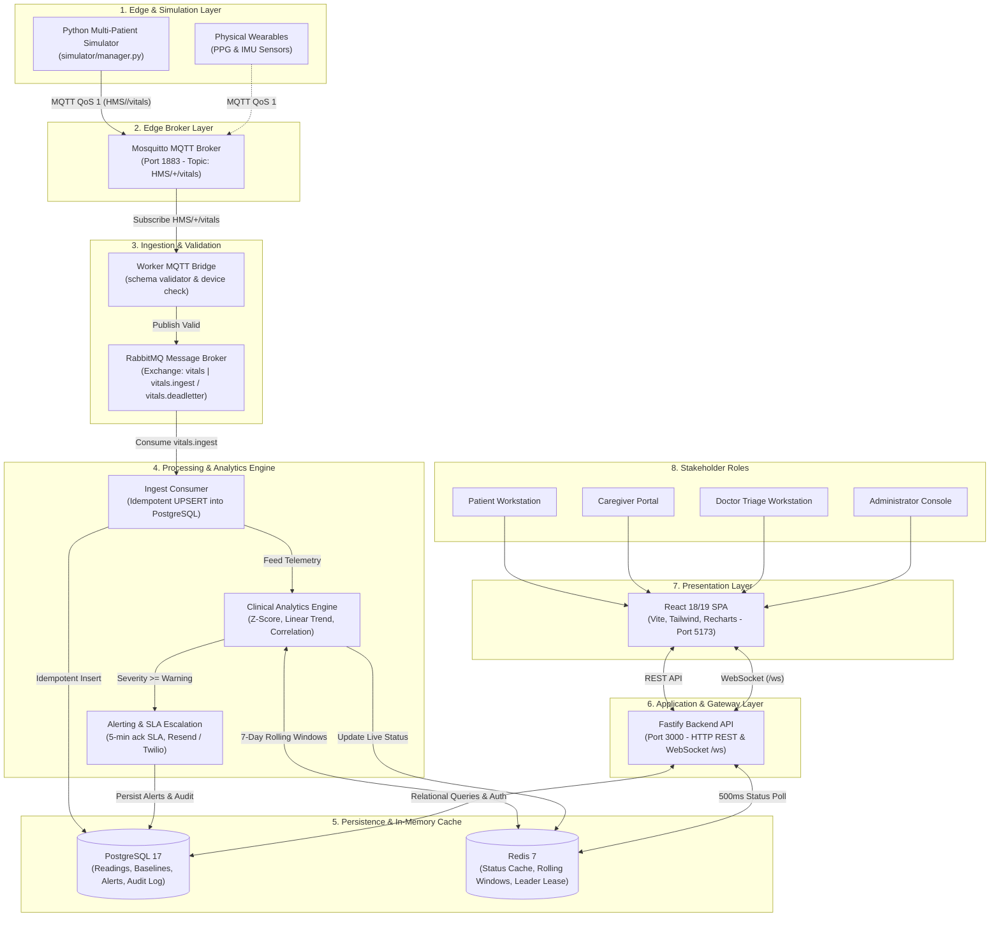

# 02 — Architecture and Technology

Evaluation Study Guide for Rohan G (241IT064, @rniszn, B.Tech IT NITK)  
Course: **IT303 - Software Engineering** | Project: **VitalGuard**

---

## 1. System Architecture

VitalGuard is designed as an event-driven, distributed IoT healthcare monitoring and clinical governance platform. It ingests continuous telemetry from edge sensors, executes analytical pipelines, alerts clinical stakeholders in real time, and exposes role-specific web interfaces for patients, caregivers, doctors, and system administrators.



---

## 2. Layer Breakdown Table

| Layer                            | Technology                                              | Why This Choice                                                                                                                                                                                                                  |
| :------------------------------- | :------------------------------------------------------ | :------------------------------------------------------------------------------------------------------------------------------------------------------------------------------------------------------------------------------- |
| **Frontend Web**                 | React 18/19, TypeScript, Vite, Tailwind CSS, Recharts   | Component reusability across 4 stakeholder dashboards, strict end-to-end type safety, sub-millisecond Vite HMR, and smooth real-time biometric chart rendering.                                                                  |
| **Backend API**                  | Node.js, Fastify, TypeScript, Drizzle ORM, Zod          | Significantly lower HTTP overhead than Express, built-in schema validation via Zod/JSON-schema, native high-concurrency WebSocket support (`@fastify/websocket`), and compile-time type inference with Drizzle.                  |
| **Relational Database**          | PostgreSQL 17                                           | Strict ACID guarantees, foreign-key data integrity across complex relational models (users, patients, doctors, associations, caregiver links, audit logs), and efficient indexed time-series queries.                            |
| **Cache & Real-Time Store**      | Redis 7                                                 | Sub-millisecond reads for latest patient vitals status, high-throughput sorted sets (`ZADD`/`ZRANGEBYSCORE`) for sliding-window baselines, and atomic distributed locking (`SET NX PX`) for simulator clustering.                |
| **Message Broker**               | RabbitMQ 4 (AMQP 0-9-1)                                 | Decouples edge ingestion from heavy analytical computing and database I/O. Supports topic exchange routing (`vitals`), durable queues (`vitals.ingest`), consumer acknowledgments, and dead-letter queues (`vitals.deadletter`). |
| **IoT Edge Broker**              | Eclipse Mosquitto 2.0 (MQTT)                            | Lightweight, low-overhead binary publish/subscribe messaging standard designed specifically for constrained medical devices, low-bandwidth edge hardware, and high-frequency sensor updates.                                     |
| **Background Processing Worker** | Node.js / TypeScript (`apps/worker`), node-cron, PDFKit | High-throughput asynchronous event loop ideal for I/O-heavy RabbitMQ consumption, statistics calculation, automated SLA alert escalation, and scheduled weekly PDF clinical report generation.                                   |
| **Edge Device Simulator**        | Python 3.10+, paho-mqtt, jsonschema                     | Rapid physiological mathematical modeling (random-walk biometrics, circadian drift, clinical deterioration curves), dynamic REST patient discovery, and autonomous scenario testing.                                             |

---

## 3. Key Design Concepts

### 1. Pub/Sub Pattern

The Publish/Subscribe pattern decouples producers of telemetry (wearables and simulators) from consumers (worker bridge and analytics). Producers publish messages to an MQTT topic without knowing who consumes them; Mosquitto routes messages based on topic filters (`HMS/+/vitals`), allowing multiple independent subscribers without altering edge device firmware.

### 2. Message Queue Decoupling

RabbitMQ acts as an asynchronous shock absorber between high-frequency edge telemetry ingestion and heavy database transactions. If database writes slow down under load, messages accumulate safely in durable queues (`vitals.ingest`) without dropping sensor packets, and invalid payloads are automatically routed to `vitals.deadletter`.

### 3. Z-Score Anomaly Detection

Rather than relying solely on arbitrary static thresholds, the analytics engine evaluates each vital sign against the patient's personalized 7-day rolling baseline:
$$z = \frac{x - \mu}{\sigma}$$
where $\mu$ is the rolling mean and $\sigma$ is the population standard deviation (with a floor of $0.01$ to prevent division by zero). A z-score magnitude $|z| \ge 1.5$ indicates mild drift (**Watch-level**), while $|z| \ge 2.0$ flags a statistically significant anomaly (**Anomalous**).

### 4. Linear Regression Trend Forecasting

The system fits an Ordinary Least Squares (OLS) regression line ($y = mx + c$) over the patient's last 10 consecutive readings ($N=10$) plotted against elapsed time in minutes. By projecting the slope forward over a 30-minute lookahead window ($t_{\text{lookahead}} = 30\text{ min}$), the engine calculates the estimated time until a clinical threshold will be breached, generating proactive early warnings before acute failure occurs.

### 5. Multi-Vital Correlation Rules

Acute clinical deterioration rarely manifests in a single vital sign. The correlation engine evaluates combinations of concurrent directional anomalies across multiple physiological parameters—such as the `correlated-deterioration` rule, which fires when Heart Rate is rising, SpO2 is falling, and Temperature is rising within a 30-minute concurrency window.

### 6. Stateless JWT Auth with Per-Request DB Validation

Authentication uses stateless HMAC-SHA256 (HS256) JSON Web Tokens containing subject (`sub`) and `role` claims, avoiding session storage lookups for identity. However, to guarantee near-instant security revocation and administrative control, the Fastify `authenticate` decorator queries PostgreSQL on each request for `mustChangePassword` and `isSuspended` flags, preventing locked or suspended users from making calls.

### 7. RBAC with Association and Consent Model

Access control combines coarse-grained Role-Based Access Control (`requireRoles`) with fine-grained entity associations (`requireAssociation`). Doctors can only access patients explicitly assigned to them in the `associations` table, and caregivers cannot access a dependent's telemetry until the caregiver request is approved by an administrator and explicitly consented to by the patient via the `patient_consents` workflow.

### 8. Ingestion Idempotency

RabbitMQ provides at-least-once message delivery, meaning network retries or worker restarts could redeliver identical packets. The ingestion consumer enforces strict idempotency at the database layer using a composite unique constraint on `(device_id, timestamp, vital_type)` combined with PostgreSQL's `ON CONFLICT DO NOTHING`, guaranteeing zero duplicate readings without spurious row locks.

---

## 4. Severity Decision Table

The clinical severity engine in `apps/worker/src/analytics/severity.ts` classifies incoming telemetry into one of four tiers (**Normal**, **Watch**, **Warning**, **Critical**) using a strict priority-ordered rule cascade:

| Priority | Condition / Trigger                                                                                                                       | Resulting Severity | Clinical Explanation & System Action                                                                                                                                                                      |
| :------: | :---------------------------------------------------------------------------------------------------------------------------------------- | :----------------: | :-------------------------------------------------------------------------------------------------------------------------------------------------------------------------------------------------------- |
|  **1**   | **Multi-vital correlation rule fired**<br>`context.correlationMatch !== null`                                                             |    **Critical**    | Heart rate rising, SpO2 falling, and temperature rising concurrently. Immediate critical alert created; SMS/email emergency notifications dispatched; 5-minute SLA timer started.                         |
|  **2**   | **Static threshold breach AND anomalous**<br>`assessment.thresholdBreached && assessment.anomalyFlag === 'anomalous'`                     |    **Critical**    | A vital has breached absolute clinical safety limits AND represents a $>2.0\sigma$ deviation from the patient's personal baseline. High-confidence acute event; emergency notifications sent.             |
|  **3**   | **Any threshold breach OR anomalous OR trend warning**<br>`thresholdBreached \|\| anomalyFlag === 'anomalous' \|\| trendWarning !== null` |    **Warning**     | A vital has crossed a static threshold, or deviated significantly from baseline, or is mathematically projected to breach safety bounds within 30 minutes. Creates an open alert on clinician dashboards. |
|  **4**   | **Watch-level anomaly**<br>`assessment.anomalyFlag === 'watch-level'` ($1.5 \le \|z\| < 2.0$)                                             |     **Watch**      | Physiological parameter is drifting away from the patient's established baseline. No clinical alarm sounded, but status card highlights yellow to prompt closer observation.                              |
|  **5**   | **All assessments normal**<br>(Default fallback)                                                                                          |     **Normal**     | Biometrics are within expected baseline and static clinical safety bounds. System status displays green.                                                                                                  |

---

## 5. End-to-End Data Flow (Device to Dashboard)

```
[ Edge Sensor / Sim ] ──(1)──> [ Mosquitto MQTT ] ──(2)──> [ Worker Bridge ]
                                                                   │ (3)
[ React Dashboard ] <──(11)── [ Fastify WS ] <──(10)── [ Redis ] <──┴─(6)─ [ Analytics Engine ]
         ▲                                                ▲                      │ (7)
         │ (12)                                           │ (9)                  ▼
  [ REST Queries ] ──────────> [ Fastify API ] ────> [ PostgreSQL ] <──── [ Ingest Consumer ]
```

1. **Telemetry Generation**: The edge device (or Python multi-patient simulator) reads PPG and accelerometer sensors, bundles readings into a JSON payload conforming to `vital-sample.schema.json`, and publishes to Mosquitto topic `HMS/<device_id>/vitals` with MQTT QoS 1.
2. **Edge Message Ingestion**: Mosquitto receives the packet and dispatches it to subscribed clients matching `HMS/+/vitals`.
3. **Bridge Validation & Normalization**: The worker MQTT bridge receives the payload, strips legacy motion fields (`fall_detected`), validates structure against JSON Schema Draft 2020-12 using Ajv, verifies device registration against the Redis cache (`device:<deviceId>:patient`) or PostgreSQL, and publishes valid samples to RabbitMQ topic exchange `vitals`.
4. **Queue Routing**: RabbitMQ routes the message to the durable `vitals.ingest` queue (routing key `vitals.sample`). Any malformed or unregistered packets are routed to `vitals.deadletter`.
5. **Idempotent Ingestion**: The worker ingest consumer pulls the sample from RabbitMQ. It splits the consolidated packet into normalized rows (`heart_rate`, `spo2`, `temperature`, `motion`) and executes an `INSERT ... ON CONFLICT (device_id, timestamp, vital_type) DO NOTHING` into PostgreSQL `vital_readings`.
6. **Sliding-Window Baseline Retrieval**: The analytics engine retrieves the patient's 7-day historical values from the Redis sorted set `baseline:window:<patientId>:<vitalType>`, calculating sample count, rolling mean ($\mu$), and standard deviation ($\sigma$).
7. **Statistical & Trend Evaluation**:
   - Calculates z-score: $z = (x - \mu) / \max(\sigma, 0.01)$.
   - Evaluates trend via linear regression on the last 10 readings to predict threshold crossing time.
   - Evaluates multi-vital correlation rules.
8. **Severity Classification**: Context is evaluated against the 5-tier Severity Decision Table, producing a final tier (`Normal`, `Watch`, `Warning`, or `Critical`) and clinical explanation.
9. **Alert Dispatch & Persistence**: If severity is `Warning` or `Critical`, an alert record is created in PostgreSQL `alerts`. If `Critical`, emergency email (Resend) and SMS (Twilio) dispatches are triggered, and an SLA acknowledgment deadline (5 minutes) is assigned.
10. **Redis Status Cache Update**: The analytics engine serializes the latest vitals, severity tier, device metadata, and explanation into Redis key `patient:<patientId>:status`.
11. **WebSocket Change Detection**: The Fastify API WebSocket gateway (`GET /ws`), which polls Redis every 500ms for subscribed patients, detects the updated status string and immediately pushes the payload to all connected browser clients.
12. **Live UI Update**: Rohan's React application receives the WebSocket frame, updates vital metric cards and status badges, appends new data points to Recharts history graphs, and sounds audio-visual triage indicators.

---

## 6. Default Vital Thresholds Table

| Vital Sign                   |    Normal Range    |  Mild Drift (Watch)   |                                    Acute Breach                                    | Config Variable & Source                                                                         |
| :--------------------------- | :----------------: | :-------------------: | :--------------------------------------------------------------------------------: | :----------------------------------------------------------------------------------------------- |
| **Heart Rate**               |  **60 – 100 bpm**  | $1.5 \le \|z\| < 2.0$ |               $< 60$ bpm (bradycardia) or $> 100$ bpm (tachycardia)                | `HEART_RATE_THRESHOLD_MIN=60`<br>`HEART_RATE_THRESHOLD_MAX=100`<br>`apps/worker/src/env.ts`      |
| **Oxygen Saturation (SpO2)** |   **$\ge$ 95%**    | $1.5 \le \|z\| < 2.0$ |                         $< 95\%$ (hypoxia / desaturation)                          | `SPO2_THRESHOLD_MIN=95`<br>`apps/worker/src/env.ts`                                              |
| **Body Temperature**         | **36.1 – 37.5 °C** | $1.5 \le \|z\| < 2.0$ | $< 36.1\ ^\circ\text{C}$ (hypothermia) or $> 37.5\ ^\circ\text{C}$ (pyrexia/fever) | `TEMPERATURE_THRESHOLD_MIN=36.1`<br>`TEMPERATURE_THRESHOLD_MAX=37.5`<br>`apps/worker/src/env.ts` |
| **Motion / Activity**        |      Dynamic       |    Continuous IMU     |                       Roll, Pitch, Accel Magnitude ($m/s^2$)                       | Accelerometer vector magnitude; flags `clean`, `noisy`, or `implausible`                         |

> [!NOTE]
> Static thresholds can be customized per patient by attending physicians using the clinician threshold override capability (`thresholds` table).

---

## 7. Redis Key Patterns

| Key Pattern                               |     Redis Type      | Purpose & Contents                                                                                                                                                                   | TTL / Eviction Policy                                                                                    |
| :---------------------------------------- | :-----------------: | :----------------------------------------------------------------------------------------------------------------------------------------------------------------------------------- | :------------------------------------------------------------------------------------------------------- |
| `patient:<patientId>:status`              |   `String` (JSON)   | Caches the latest evaluated status for a patient: current vital values, units, quality flags, severity tier, explanation text, and device metadata. Polled by the WebSocket gateway. | Updated on every incoming sample; persisted until overwritten.                                           |
| `baseline:window:<patientId>:<vitalType>` | `Sorted Set` (ZSET) | Stores historical readings over a rolling window. Score = epoch timestamp in seconds, Member = vital value. Used to compute 7-day rolling mean and standard deviation.               | Pruned during ingestion: entries older than 7 days (`now - 7*86400`) are evicted via `ZREMRANGEBYSCORE`. |
| `patient:<patientId>:recent-readings`     |   `List` / `ZSET`   | Stores the most recent 10 consecutive readings used by the OLS linear regression engine to calculate rate of change and time-to-threshold crossing.                                  | Trimmed to maintain fixed sliding sample count (`TREND_SAMPLE_COUNT=10`).                                |
| `device:<deviceId>:patient`               |   `String` (JSON)   | Caches device registration status and assigned patient UUID so the worker MQTT bridge can verify device authorization without hitting PostgreSQL.                                    | Refreshed on device assignment changes.                                                                  |
| `simulator:leader:lease`                  |      `String`       | Distributed leader lease lock acquired by the Python simulator manager using `SET NX PX 10000` to guarantee single-master execution in clustered environments.                       | 10 seconds; refreshed periodically by simulator heartbeat.                                               |

---

## 8. MQTT Message Schema

Telemetry is transmitted over MQTT via topic:

```
HMS/<device_id>/vitals
```

where `<device_id>` is the UUID or serial string of the edge hardware.

### Complete JSON Payload Example

```json
{
  "device_id": "d3b07384-d113-49cd-a5e6-81498b8137a1",
  "patient_id": "a1b2c3d4-e5f6-7a8b-9c0d-1e2f3a4b5c6d",
  "timestamp": "2026-10-16T12:00:00.000Z",
  "heart_rate": {
    "value": 72.5,
    "unit": "bpm",
    "quality": "clean"
  },
  "spo2": {
    "value": 98.0,
    "unit": "percent",
    "quality": "clean"
  },
  "temperature": {
    "value": 36.8,
    "unit": "celsius"
  },
  "motion": {
    "roll": 2.4,
    "pitch": -1.1,
    "accel_magnitude": 9.81
  },
  "gap": false
}
```

### Schema Field Definitions

| Field                    |   Type    | Validation / Constraints                  | Description                                                             |
| :----------------------- | :-------: | :---------------------------------------- | :---------------------------------------------------------------------- |
| `device_id`              | `string`  | Min length 1; matches topic `<device_id>` | Hardware device identifier                                              |
| `patient_id`             | `string`  | Min length 1; UUID                        | Associated patient account identifier                                   |
| `timestamp`              | `string`  | ISO 8601 UTC with trailing `Z`            | Exact moment biometric sample was captured                              |
| `heart_rate.value`       | `number`  | Physiological range (typically 30–250)    | Heart beats per minute                                                  |
| `heart_rate.unit`        | `string`  | Constant `"bpm"`                          | Unit of measurement                                                     |
| `heart_rate.quality`     | `string`  | `"clean"` \| `"noisy"` \| `"implausible"` | Signal quality indicator from PPG sensor                                |
| `spo2.value`             | `number`  | Percentage (typically 70–100)             | Blood oxygen saturation percentage                                      |
| `spo2.unit`              | `string`  | Constant `"percent"`                      | Unit of measurement                                                     |
| `spo2.quality`           | `string`  | `"clean"` \| `"noisy"` \| `"implausible"` | Pulse oximetry signal quality                                           |
| `temperature.value`      | `number`  | Celsius degrees (typically 30.0–45.0)     | Core body temperature                                                   |
| `temperature.unit`       | `string`  | Constant `"celsius"`                      | Unit of measurement                                                     |
| `motion.roll`            | `number`  | Angular orientation                       | Gyroscope roll axis                                                     |
| `motion.pitch`           | `number`  | Angular orientation                       | Gyroscope pitch axis                                                    |
| `motion.accel_magnitude` | `number`  | Minimum 0 ($m/s^2$)                       | Euclidean magnitude of accelerometer vector                             |
| `gap`                    | `boolean` | `true` \| `false`                         | Indicates whether reading was flushed after a temporary edge disconnect |

> [!IMPORTANT]
> **Fall Detection Removal**:
> The `motion.fall_detected` boolean flag was permanently removed from the active system schema to avoid spurious clinical emergency dispatches caused by noisy IMU sensor spikes. For backward compatibility with legacy edge hardware or simulators, the worker MQTT bridge (`apps/worker/src/bridge/schema-validator.ts`) automatically strips `fall_detected` from in-flight JSON payloads before schema validation.
