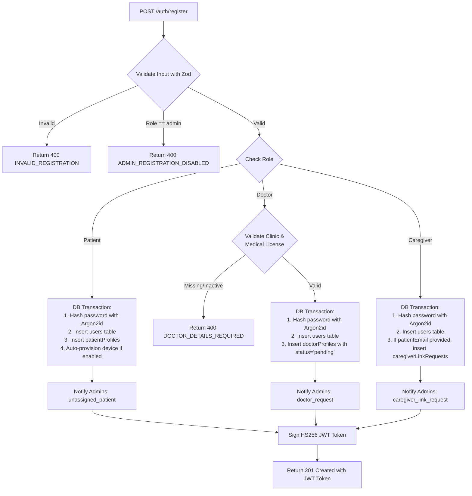
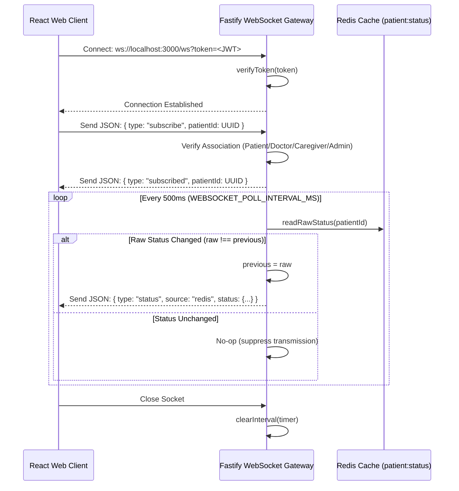
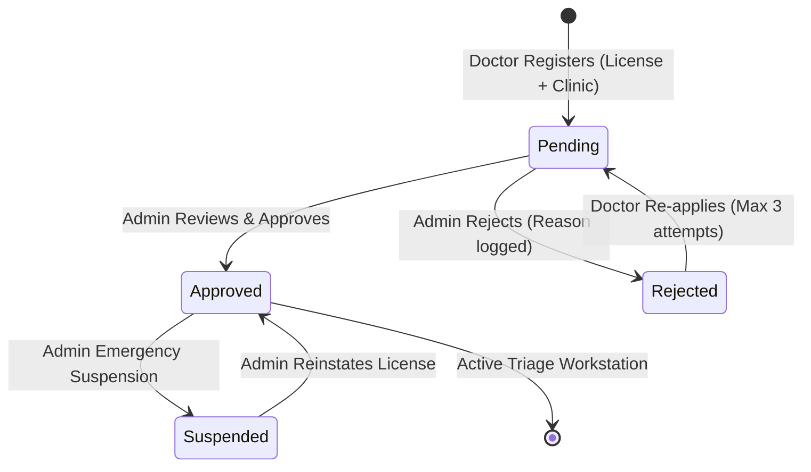

# 03 — My Part: Deep Dive (API + Web)

Evaluation Study Guide for Rohan G (241IT064, @rniszn, B.Tech IT NITK)  
Course: **IT303 - Software Engineering** | Project: **VitalGuard**

---

## 1. Context & Ownership Overview

In the project's repository organization and repository governance:

- **Primary Code Ownership (`.github/CODEOWNERS`)**:
  - `apps/web/` is owned by **Rohan (@rniszn)**.
  - `apps/api/` is owned by **Karan (@karan-h-2006)**.
  - `simulator/` and `infra/` are owned by **Vikas (@feyman137035)**.
- **Collaborative Full-Stack Scope**:
  While Rohan directly architected and authored the entire React 18/19 Single Page Application (`apps/web/`), he co-designed and thoroughly reviewed the Fastify REST & WebSocket API contracts (`apps/api/`), the data schemas (`drizzle/schema.ts`), and the authentication/authorization subsystems.
- **Evaluation Purpose**:
  This document serves as Rohan's comprehensive technical defense for the entire application layer (**Web Frontend + Backend API**), ensuring complete mastery over registration, Argon2id security, token lifecycles, RBAC, WebSocket streaming, clinical triage workflows, administrative governance, and test coverage.

---

## 2. Authentication System

The authentication subsystem is implemented in `apps/api/src/auth/` and `apps/api/src/features/auth/routes.ts`.

### 2.1 Registration Flow Step-by-Step

Registration is handled by `POST /auth/register` with strict payload validation via Zod (`registrationSchema`):



1. **Patient Registration**:
   - Creates a user record in `users` with `role: 'patient'`.
   - Inserts a profile in `patient_profiles` with `preferredInstitutionId` (if supplied) and `assignmentStatus: 'unassigned'`.
   - **Simulated Device Auto-Provisioning**: If `AUTO_PROVISION_SIMULATED_DEVICE=true`, it immediately creates an entry in `devices` with `isSimulated: true`, `registrationStatus: 'registered'`, and `simScenario: 'normal'`. The Python simulator automatically discovers this device in $<15$ seconds via `/internal/simulated-devices`.
   - Dispatches an administrative notification (`notifyAdmins`) indicating a new unassigned patient requires physician onboarding.
2. **Doctor Registration**:
   - Requires `institutionId`, `medicalLicenseNo`, and `specialization`.
   - Validates that the targeted medical institution exists and is `active`.
   - Inserts `doctor_profiles` with `status: 'pending'` and `reapplicationCount: 0`.
   - Doctors cannot access patient data until reviewed and approved by an administrator.
3. **Caregiver Registration**:
   - Optionally accepts `patientEmail`. If provided and matching an existing patient, creates a record in `caregiver_link_requests` with `status: 'pending'` and `patientConsent: 'pending'`.
4. **Administrator Self-Registration Guard**:
   - The route explicitly rejects any registration with `role === 'administrator'` or `'admin'`, returning `400 ADMIN_REGISTRATION_DISABLED`.
   - Administrator accounts must be created through database seeding (`node dist/db/seed.js`) or via an existing authenticated admin.

### 2.2 Login Flow & Anti-Enumeration Design

Handled by `POST /auth/login`:

1. Normalizes email to lowercase: `email.toLowerCase()`.
2. Evaluates the login rate limiter keyed by `${request.ip}:${email}`.
3. Queries `users` table for the matching email.
4. If the user does not exist OR `verifyPassword(user.passwordHash, input.password)` returns false:
   - Increments the rate limit attempt counter.
   - **Anti-Enumeration Guard**: Always returns HTTP 401 with identical payload:
     ```json
     { "code": "INVALID_CREDENTIALS", "message": "invalid credentials" }
     ```
   - **Viva Defense**: We return the exact same error code and message regardless of whether the email was not found or the password was incorrect. If we returned "User not found", malicious actors could systematically probe our endpoint to enumerate registered patients, doctors, and staff emails.
5. On successful password verification:
   - Clears the failed rate limit counter for `${request.ip}:${email}`.
   - Signs and returns an HS256 JWT token.

### 2.3 Password Hashing with Argon2id

Implemented in `apps/api/src/auth/passwords.ts`:

```typescript
export async function hashPassword(password: string): Promise<string> {
  return argon2.hash(password, { type: argon2.argon2id });
}
export async function verifyPassword(
  passwordHash: string,
  password: string,
): Promise<boolean> {
  return argon2.verify(passwordHash, password);
}
```

- **Minimum Password Length**: Enforced by Zod and `MINIMUM_PASSWORD_LENGTH = 10` for standard users, and `12` characters for administrators.
- **Why Argon2id over bcrypt/PBKDF2**:
  - **Memory-Hardness**: Bcrypt is CPU-bound and cache-limited; custom FPGA and GPU clusters can execute millions of parallel password guesses per second. Argon2id requires configurable amounts of memory (RAM) for each hash computation, neutralizing massive GPU parallelization.
  - **Hybrid Side-Channel Resistance**: Argon2id combines Argon2d (resistant to GPU cracking via data-dependent memory access) and Argon2i (resistant to side-channel cache-timing attacks via data-independent memory access), making it the gold standard (winner of the Password Hashing Competition).

### 2.4 JWT Structure & Role-Specific Lifetimes

Implemented in `apps/api/src/auth/tokens.ts` using the `jose` library:

- **Algorithm**: `HS256` (HMAC with SHA-256) signed with `JWT_SECRET`.
- **Claims**:
  - `sub`: User UUID (`users.id`).
  - `role`: `'patient'` | `'caregiver'` | `'doctor'` | `'administrator'`.
  - `patientId`: If `role === 'patient'`, sets `patientId = userId` for fast authorization checks.
  - `iat`: Epoch timestamp when token was issued.
  - `exp`: Expiration timestamp.
- **Differential Token Lifetimes**:
  - **Standard Users** (`patient`, `caregiver`, `doctor`): Defaults to `1h` (`JWT_EXPIRES_IN`).
  - **Administrators**: Defaults to `30m` (`ADMIN_JWT_EXPIRES_IN`).
  - **Viva Defense**: Shorter administrative lifetimes adhere to the Principle of Least Privilege and minimize the window of exposure should an administrator workstation be left unattended.

### 2.5 Forced Password Change (`mustChangePassword`)

- When bootstrapped via database seeding, administrators start with `mustChangePassword: true`.
- The Fastify `authenticate` decorator checks `users.mustChangePassword` in the database on **every authenticated request**.
- If `true`, all endpoints return `403 PASSWORD_CHANGE_REQUIRED`, except:
  1. `/auth/change-password`
  2. `/auth/me`
  3. `/auth/logout`
- In the frontend, `apiFetch` catches `PASSWORD_CHANGE_REQUIRED` and dispatches `vitalguard:password-change-required`, seamlessly redirecting the user to `/change-password` without terminating their session.

### 2.6 Emergency Account Suspension (`isSuspended`)

- Administrators can immediately suspend compromised users via `POST /admin/users/:userId/suspend`.
- Checked on **every request** by `authenticate`. If `isSuspended: true`, the API rejects all calls with `403 ACCOUNT_SUSPENDED` (except `/auth/me` and `/auth/logout`).
- **Viva Defense**: This achieves instantaneous session invalidation without maintaining an expensive, distributed token blacklist.

### 2.7 Rate Limiting Design

- Guarded by an in-memory `Map<string, { count: number; resetAt: number }>`:
  - **Standard Login**: 5 attempts per 60 seconds (`LOGIN_RATE_LIMIT_MAX=5`, `LOGIN_RATE_LIMIT_WINDOW_SECONDS=60`).
  - **Admin Login**: 3 attempts per 300 seconds (5 minutes) (`ADMIN_LOGIN_RATE_LIMIT_MAX=3`, `ADMIN_LOGIN_RATE_LIMIT_WINDOW_SECONDS=300`).
  - **Public Institutions**: 30 requests per minute per IP.
- **Architectural Limitation & Viva Honesty**: The current rate limiter operates in-memory per API Node.js process. In a horizontally scaled production deployment with multiple API replicas behind a load balancer, this must be migrated to a shared Redis sliding-window counter (`INCR` with `EXPIRE`).

---

## 3. Authorization & RBAC Architecture

Access control is governed by Fastify plugins in `apps/api/src/plugins/auth.ts`.

### 3.1 The `authenticate` Decorator

Decorates Fastify with a per-request pre-handler hook:

1. Extracts `Bearer <token>` from the HTTP `Authorization` header.
2. Validates JWT signature and claims using `verifyToken()`.
3. Performs a single indexed query to PostgreSQL `users` table:
   ```typescript
   const [account] = await app.database
     .select({
       mustChangePassword: users.mustChangePassword,
       isSuspended: users.isSuspended,
     })
     .from(users)
     .where(eq(users.id, request.authUser.userId))
     .limit(1);
   ```
4. Verifies account exists, is not suspended, and evaluates `mustChangePassword`.
5. Attaches the validated `authUser` object (`userId`, `role`, `patientId`) to `request.authUser`.

### 3.2 Role and Clinical Guard Pre-Handlers

- `requireRoles(...roles)`: Fastify pre-handler ensuring `request.authUser.role` is in the allowed whitelist (e.g., `requireRoles('administrator')`).
- `isDoctorApproved`: Queries `doctor_profiles` table on each request.
  - **Viva Defense**: Why not bake doctor approval into the JWT token? Doctor approval is an asynchronous administrative workflow. If encoded in the JWT, an approved doctor would have to log out and log back in to gain access, or a suspended doctor could continue accessing clinical records until token expiry. A lightweight indexed DB check ensures real-time clinical governance.

### 3.3 Fine-Grained Entity Authorization (`requireAssociation`)

Protects all patient-specific endpoints (`/patients/:patientId/*`):

```typescript
export function decideRbacAccess(
  role: AuthUser['role'],
  requestingUserId: string,
  targetPatientId: string,
  associationExists: boolean,
  doctorApproved = true,
): boolean {
  if (role === 'administrator') return true;
  if (role === 'patient') return requestingUserId === targetPatientId;
  if (role === 'doctor') return doctorApproved && associationExists;
  if (role === 'caregiver') return associationExists;
  return false;
}
```

1. **Administrator**: Full platform visibility (returns `true`).
2. **Patient**: Can only access their own record (`requestingUserId === targetPatientId`).
3. **Doctor**: Must have `doctorApproved === true` AND an active record in the `associations` table.
4. **Caregiver**: Must have an active record in the `association_caregivers` table.
5. All other requests are rejected with `403 not authorized for this patient`.

---

## 4. Dashboard and Vitals API

Implemented in `apps/api/src/features/dashboard/routes.ts`:

### 4.1 Route Catalog

| Method | Path                                              | Allowed Roles                                          | Description & Return Schema                                                                                                                                                           |
| :----- | :------------------------------------------------ | :----------------------------------------------------- | :------------------------------------------------------------------------------------------------------------------------------------------------------------------------------------ |
| `GET`  | `/patients/:patientId/vitals/latest`              | Patient (self), Linked Doctor, Linked Caregiver, Admin | Returns latest biometric status from Redis/Postgres: vitals values, units, quality flags, severity tier, clinical explanation, and device metadata.                                   |
| `GET`  | `/patients/:patientId/vitals/history`             | Patient (self), Linked Doctor, Linked Caregiver, Admin | Returns historical time-series points. Query params: `vitalType` (`heart_rate`, `spo2`, `temperature`, `motion`) and `range` (`24h`, `7d`, `30d`).                                    |
| `GET`  | `/patients`                                       | Approved Doctors, Caregivers                           | Clinical triage roster: returns array of linked patients sorted descending by severity tier (Critical > Warning > Watch > Normal), with open alert counts and last reading timestamp. |
| `GET`  | `/patients/:patientId/reports`                    | Patient (self), Linked Doctor, Linked Caregiver, Admin | Lists metadata of all generated weekly PDF reports for the patient.                                                                                                                   |
| `POST` | `/patients/:patientId/reports`                    | Linked Doctor, Linked Caregiver                        | Generates an on-demand clinical PDF report aggregating 7-day vitals and alert counts.                                                                                                 |
| `GET`  | `/patients/:patientId/reports/:reportId/download` | Patient (self), Linked Doctor, Linked Caregiver, Admin | Streams the binary PDF report file (`Content-Type: application/pdf`).                                                                                                                 |
| `GET`  | `/ws`                                             | Authenticated Users with Association                   | High-throughput WebSocket stream for live status pushes.                                                                                                                              |

### 4.2 History Range Offset Logic

Extracted into pure unit-tested helper `parseHistoryRangeHours(range)`:

- `'24h'` (or default) $\to 24\text{ hours}$ ($86,400,000\text{ ms}$)
- `'7d'` $\to 168\text{ hours}$
- `'30d'` $\to 720\text{ hours}$
- Any invalid string $\to 0$ (triggers HTTP 400 Bad Request)

### 4.3 Clinical Triage Sorting (`GET /patients`)

Physicians need to immediately identify which patients require urgent intervention:
$$\text{Rank}: \text{Critical (4)} > \text{Warning (3)} > \text{Watch (2)} > \text{Normal (1)}$$
The endpoint queries all linked patients from `associations`, fetches their latest status, counts open alerts, and sorts the list using `sortPatientsByTriage()`.

### 4.4 WebSocket Gateway Architecture (`GET /ws`)



---

## 5. Clinical Reports Generation System

Implemented in `apps/api/src/features/dashboard/reports.ts` and `apps/worker/src/reports.ts`:

- **Data Aggregation**: `computeReportAggregations` queries PostgreSQL for all readings and alerts over a 7-day window. It computes mathematical averages for each vital sign and tallies alert occurrences per severity tier.
- **PDF Generation**: Streams raw PDF 1.4 byte structures formatted with Helvetica typefaces, clinical metadata, and tabular alert counts into `generated-reports/<patientId>-<date>.pdf`.
- **Scheduled Cron Job**: A worker cron job scheduled for **Sunday at midnight** (`0 0 * * 0`) iterates over all registered patients and generates their weekly clinical summary.
- **On-Demand Generation**: Clinicians can trigger report generation immediately via `POST /patients/:patientId/reports`.
- **Architectural Limitation & Viva Honesty**: Reports are currently written to local disk (`generated-reports/`). In a production multi-tenant cloud deployment, this must be backed by an S3-compatible object store (AWS S3, MinIO, or Google Cloud Storage) with signed download URLs.

---

## 6. Clinical Governance & Admin Features

Implemented in `apps/api/src/features/governance/admin-routes.ts`:

### 6.1 Route Catalog

- `GET /admin/overview`: Global system summary (pending doctor requests, unassigned patients, active alerts, total users).
- `GET /admin/institutions`, `POST /admin/institutions`, `PATCH /admin/institutions/:id`: Hospital/clinic registry management.
- `GET /admin/users`, `POST /admin/users/:userId/suspend`, `POST /admin/users/:userId/reinstate`: User lifecycle governance.
- `GET /admin/audit-log`: Immutable regulatory audit trail with actor/target email resolution and JSON before/after state diffs.
- `GET /admin/doctor-requests`: Triage pending physician applications.
- `POST /admin/doctor-requests/:userId/approve`: Approves doctor license and activates triage workstation access.
- `POST /admin/doctor-requests/:userId/reject`: Rejects application with required reason text; increments `reapplicationCount` (capped at 3).
- `POST /admin/doctors/:userId/suspend`, `POST /admin/doctors/:userId/reinstate`: Clinical license suspension.
- `GET /admin/patients`: Filterable patient roster (by assignment status and institution).
- `POST /admin/patients/:patientId/assign-doctor`: Links an unassigned patient to an approved physician.
- `POST /admin/patients/:patientId/transfer`: Transfers patient to a different institution and reassigns primary physician.
- `DELETE /admin/patients/:patientId/doctors/:doctorId`: Removes doctor association.
- `GET /admin/caregiver-requests`: Roster of pending caregiver link applications.
- `POST /admin/caregiver-requests/:id/approve`: Admin approves caregiver link; transitions to awaiting patient consent.
- `POST /admin/caregiver-requests/:id/reject`: Rejects caregiver link request.
- `PATCH /admin/devices/:deviceId`: **Simulation Scenario Injection** (injects `normal`, `deteriorating`, `tachycardia`, `bradycardia`, `hypoxia`, `fever`, `sensor_noise`, `disconnect`).
- `GET /notifications`, `POST /notifications/read-all`, `POST /notifications/:id/read`: In-app notification center.
- `POST /admin/totp/enroll`, `POST /admin/totp/verify`: Two-factor authentication stub (returns 501 / 409 depending on flag).

### 6.2 Doctor Licensing & Onboarding Workflow



### 6.3 Caregiver Link & Patient Privacy Consent Flow

To prevent unauthorized surveillance, caregiver onboarding follows a strict 3-stage consent protocol:

1. **Caregiver Request**: Caregiver submits link request via `/caregiver` specifying patient email and relationship note.
2. **Administrative Vetting**: Administrator reviews the request in the Admin Console (`/admin/caregiver-requests`) and verifies legitimacy.
3. **Patient Explicit Consent**: The link remains **inactive** until the patient logs into `/patient/access` and explicitly clicks **Grant Consent**. Only upon patient consent is a row written to `association_caregivers`.

### 6.4 Regulatory Audit Log (`admin_audit_log`)

Every administrative action (suspension, approval, rejection, transfer, scenario injection) records:

- `actorId`: Admin who took the action.
- `action`: Canonical action string (e.g., `doctor_approved`, `user_suspended`).
- `targetType`: Entity type (`user`, `doctor`, `patient`, `institution`).
- `targetId`: UUID of the affected entity.
- `before` / `after`: JSON snapshots of the modified database row.
- `ip`: Network IP address of the caller.
- `createdAt`: Tamper-evident timestamp.

---

## 7. React Web Application Deep Dive

Implemented in `apps/web/src/`:

### 7.1 Client-Side Route Map (`apps/web/src/app.tsx`)

| Path               | Allowed Role    | Component                   | Purpose                                                                                                          |
| :----------------- | :-------------- | :-------------------------- | :--------------------------------------------------------------------------------------------------------------- |
| `/`                | Public          | `RootRoute` / `LandingPage` | Public marketing/landing page; redirects authenticated users to their role dashboard (`/${user.role}`).          |
| `/login`           | Public          | `LoginPage`                 | Authentication screen; handles error banners, redirect parameters (`returnUrl`), and session expiration notices. |
| `/register`        | Public          | `RegisterPage`              | Role-aware registration form with dynamic fields (doctor license, patient institution, caregiver link).          |
| `/patient`         | `patient`       | `PatientPage`               | Live vitals workstation, physiological history graphs, and device status indicators.                             |
| `/caregiver`       | `caregiver`     | `CaregiverPage`             | Multi-dependent monitoring roster and caregiver link application tracker.                                        |
| `/doctor`          | `doctor`        | `DoctorPage`                | High-urgency clinical triage workstation with descending severity sorting.                                       |
| `/doctor/pending`  | `doctor`        | `DoctorPendingPage`         | Status review page for unapproved doctors showing review status, rejection explanations, and reapplication form. |
| `/change-password` | All Auth        | `ChangePasswordPage`        | Mandatory password update screen; enforced when `mustChangePassword === true`.                                   |
| `/patient/access`  | `patient`       | `PatientAccessPage`         | "Who can see my data?" consent management portal for reviewing and revoking caregiver access.                    |
| `/administrator`   | `administrator` | `AdministratorPage`         | Dedicated 8-tab governance workstation protected by an isolated React Error Boundary.                            |

### 7.2 Centralized Frontend Authentication Flow

Implemented in `apps/web/src/shared/auth/auth-context.tsx` and `api-fetch.ts`:

- **Token Persistence**: JWT is saved in `localStorage` under key `vitalguard_token`.
- **Client Decoding**: `decodeToken()` decodes base64url payload (`sub`, `role`, `exp`) using `atob`, verifying expiration against `Date.now()`.
- **Event-Driven Session Management (`api-fetch.ts`)**:
  - Catches HTTP `401` on authenticated requests $\to$ dispatches `vitalguard:session-expired` $\to$ clears session and redirects to `/login?expired=true`.
  - Catches HTTP `403` with `code: 'PASSWORD_CHANGE_REQUIRED'` $\to$ dispatches `vitalguard:password-change-required` $\to$ redirects to `/change-password` without clearing credentials.
  - Leaves HTTP 403/404/500 errors intact for localized UI handling.

### 7.3 Role Route Guard (`ProtectedRoute`)

Guards all private routes:

1. Checks token presence and validity; redirects unauthenticated visitors to `/login`.
2. Checks `mustChangePassword`: forces redirect to `/change-password`.
3. Evaluates doctor approval state: if `user.role === 'doctor'` and status is not `approved`, redirects to `/doctor/pending`.
4. Evaluates `allowedRoles`: if user tries to navigate to an unauthorized portal, redirects them to their own authorized dashboard (`/${user.role}`).

### 7.4 Key UI Components

- **`PatientDetail`**: Displays live metric cards for Heart Rate, SpO2, Temperature, and Motion. Employs Recharts `ResponsiveContainer` and `LineChart` for interactive 24h/7d/30d time-series rendering.
- **`TriageDashboard`**: Shared clinical triage workstation for doctors and caregivers, color-coding severity tiers and surfacing open alert counts.
- **`AdministratorPage`**: 8-tab interface (`overview`, `doctor-requests`, `institutions`, `doctors`, `patients`, `caregivers`, `users`, `audit`) with integrated scenario injection controls.
- **Hierarchical `ErrorBoundary`**: Wraps the root application and isolates the administrative console (`level="admin"`), guaranteeing that an unhandled rendering error in a complex data table will not crash the entire application.

---

## 8. Testing & Quality Assurance

### 8.1 Automated Test Suite Summary

- **API Unit Tests (`apps/api/test/unit/`)**:
  - `auth.unit.test.ts`: Verifies Argon2id password hashing, token generation, token verification, and pure RBAC decision functions (`decideRbacAccess`).
  - `governance.unit.test.ts`: Validates doctor assignment eligibility rules (`assessDoctorAssignment`), audit log label resolution, and caregiver link activation conditions.
  - `dashboard.unit.test.ts`: Tests history range parser (`parseHistoryRangeHours`), triage sorting order (`sortPatientsByTriage`), and WebSocket push wrapping (`wrapStatusPush`).
  - `auto-provision-e2e.unit.test.ts`: Tests device registration logic and simulated provisioning flags.
- **Web Unit Tests (`apps/web/src/`)**:
  - `api-fetch.test.ts`: Tests event dispatching for session expiration (401) and forced password change (403), confirming 404/500 errors do not terminate sessions.
  - `error-boundary.test.tsx`: Validates fallback rendering and error isolation across component trees.
  - `administrator-page.test.tsx`: Tests tab navigation, table rendering, and state management.
  - `app.test.tsx`: Tests router navigation and protected route redirects.

### 8.2 Known Testing Gaps & Honest Limitations

1. **In-Memory Rate Limiting**: Unit tests verify rate limiting logic in isolation, but distributed multi-process rate limiting is not tested because Redis rate limiting is not yet implemented.
2. **Real Hardware Drivers**: Telemetry tests utilize simulated MQTT streams; physical BLE/PPG hardware driver timing is not covered.
3. **PDF Visual Regression**: Reports testing asserts mathematical aggregations and PDF byte streams, but does not execute visual layout diffing.
4. **WebSocket Concurrency**: Tested under standard unit-test mock connections, not under simulated load of 10,000 concurrent sockets.

---

## 9. Viva Examiner Probes & Model Answers

### Probe 1: "What happens if an attacker steals a user's JWT? Since JWTs are stateless, can the attacker access data until the token expires?"

> **Model Answer:**  
> "In traditional stateless JWT setups, yes—a stolen token remains valid until expiry. However, in VitalGuard, we implemented **stateless verification with per-request database validation**. The Fastify `authenticate` decorator verifies the cryptographic signature with `jose`, and then immediately executes a lightweight indexed query against PostgreSQL to check `isSuspended` and `mustChangePassword`. If an administrator suspends the account, the very next request made with the stolen token is rejected with `403 ACCOUNT_SUSPENDED`. This gives us near-instant revocation without maintaining a distributed token blacklist."

### Probe 2: "Why does `POST /auth/login` return the exact same error code (`INVALID_CREDENTIALS`) when the email is missing versus when the password is wrong?"

> **Model Answer:**  
> "Returning distinct errors like 'User not found' versus 'Incorrect password' allows malicious actors to conduct **user enumeration attacks**. By scripting requests against the login endpoint, an attacker could build a database of registered patient emails. By returning an identical `INVALID_CREDENTIALS` code and timing-safe password verification, the API reveals zero information about whether an account exists."

### Probe 3: "Why did you choose Argon2id instead of standard bcrypt for password hashing?"

> **Model Answer:**  
> "Bcrypt is CPU-bound and cache-limited. Because it uses very little RAM, attackers can deploy parallelized GPU clusters or custom ASICs to crack bcrypt hashes at billions of hashes per second. Argon2id is **memory-hard**; it requires configurable megabytes of RAM per hash calculation. This prevents GPU acceleration because GPUs lack the dedicated high-capacity RAM per core needed to run parallel attacks. Additionally, Argon2id combines data-dependent and data-independent memory passes, protecting against both GPU cracking and side-channel cache-timing attacks."

### Probe 4: "Why isn't doctor approval status stored directly as a claim inside the JWT?"

> **Model Answer:**  
> "Doctor registration requires administrative review of their medical license and clinic affiliation, which is an asynchronous workflow. If approval status were encoded inside the JWT, an approved doctor would have to log out and log back in to refresh their claims. More critically, if an administrator revoked or suspended a doctor's license due to malpractice, the doctor could continue querying sensitive patient telemetry until their JWT expired. By performing a fast indexed check on `doctor_profiles.status` during clinical requests, clinical governance is enforced immediately in real time."

### Probe 5: "Where is the authentication session stored in the browser, and what are the security trade-offs?"

> **Model Answer:**  
> "Currently, the JWT is stored in browser `localStorage` under `vitalguard_token`. The trade-off is that `localStorage` is accessible to JavaScript, making it theoretically vulnerable to Cross-Site Scripting (XSS) attacks. In our production hardening roadmap, we recommend migrating this token to a secure, `httpOnly`, `SameSite=Strict` cookie paired with CSRF tokens so client-side scripts cannot access the raw credentials."

### Probe 6: "How does the WebSocket gateway stream live updates to the browser without overwhelming the server?"

> **Model Answer:**  
> "Clients connect to `GET /ws?token=<JWT>` and send a `{ type: 'subscribe', patientId }` message. The Fastify server verifies that the user is authorized to view that patient via `requireAssociation`. Instead of re-querying PostgreSQL, the gateway sets up an interval that polls the sub-millisecond Redis status cache (`patient:<patientId>:status`) every 500ms. It compares the raw JSON string with the previously sent payload; if the string has not changed, it suppresses transmission. Only when telemetry processing alters the status does the gateway serialize and push a WebSocket frame to the client."

---

## 8. Doctor Availability Feature (Migration 0008)

> Added in `feature/doctor-availability`. This section covers the full end-to-end of how the availability toggle works.

### 8.1 Why Availability?

When a doctor goes on leave, patients already assigned to them remain in their care (alerts keep routing to them — patient safety). However, the administrator must not accidentally assign **new** patients to an unavailable doctor. The feature adds a self-service toggle with an optional note and optional return time, enforces the constraint at the API level (HTTP 409), and surfaces it in the admin UI.

### 8.2 Data Model Changes

Migration `0008_doctor_availability.sql` (additive only):

```sql
CREATE TYPE doctor_availability AS ENUM ('available', 'unavailable');
ALTER TABLE doctor_profiles
  ADD COLUMN availability_status   doctor_availability NOT NULL DEFAULT 'available',
  ADD COLUMN availability_note     text,
  ADD COLUMN availability_updated_at timestamptz NOT NULL DEFAULT now(),
  ADD COLUMN unavailable_until     timestamptz;
ALTER TABLE doctor_profiles
  ADD CONSTRAINT doctor_profiles_availability_note_length CHECK (char_length(availability_note) <= 200);
```

All existing rows backfill to `available` via the column default.

### 8.3 Effective Availability Helper

`apps/api/src/features/governance/availability.ts` exports `getEffectiveAvailability(profile, now)`:

- Non-approved doctors → always `unavailable` (they cannot be assigned anyway)
- Approved doctor with `availabilityStatus = 'available'` → `available`
- Approved doctor with `availabilityStatus = 'unavailable'` and `unavailableUntil` in the past → `available` (auto-return, no cron needed)
- Otherwise → `unavailable`

### 8.4 New API Routes

| Method  | Path                       | Guard           | Description                                                              |
| ------- | -------------------------- | --------------- | ------------------------------------------------------------------------ |
| `GET`   | `/doctors/me/availability` | Approved doctor | Returns `{ status, effectiveStatus, note, unavailableUntil, updatedAt }` |
| `PATCH` | `/doctors/me/availability` | Approved doctor | Updates status, note, unavailableUntil. Idempotent (no dup audit rows).  |

Changed routes:

- `GET /admin/doctors` — adds `?availability=available|unavailable` filter (on effective status) and `availability` object + `assignedPatientCount` in each item
- `GET /admin/overview` — adds `availableDoctors` and `unavailableDoctors` counts
- `POST /admin/patients/:id/assign-doctor` — rejects unavailable target with HTTP 409 `DOCTOR_UNAVAILABLE`
- `POST /admin/patients/:id/transfer` — rejects unavailable target with HTTP 409 `DOCTOR_UNAVAILABLE`

### 8.5 Enforcement Design

Inside the assign and transfer transactions, after fetching the doctor row, we execute a `SELECT ... FOR SHARE` lock to prevent a concurrent `PATCH /doctors/me/availability` from switching the doctor to unavailable between the read and the write. The `assessDoctorAssignment()` function gains two new parameters: `availabilityStatus` and `unavailableUntil`, and a new return value `'doctor_unavailable'`.

**Transfer FROM an unavailable doctor works** (only the target is checked). **Unassign always works.**

### 8.6 Audit and Notifications

- Every availability change writes an `admin_audit_log` row with `action = 'doctor.availability_changed'`, before/after state including the note.
- When a doctor switches to Unavailable **and has ≥1 assigned patient**, `notifyAdmins()` is called with type `doctor_unavailable`. Idempotent: if nothing changed, no audit row or notification is written.
- No notification for auto-return (it's handled on next read, no cron).

### 8.7 Web: Doctor Dashboard

`apps/web/src/features/doctor/` gains:

- `use-availability.ts` — React hook, optimistic updates, rollback on error, toast
- `availability-control.tsx` — toggle switch (ARIA `role="switch"`), note field with 200-char counter, optional datetime picker for return time
- `availability-indicator.tsx` — small `[Unavailable]` badge in the top bar, polls every 60s

`TriageDashboard` gains a `showAvailability?: boolean` prop; `DoctorPage` passes `true`.

### 8.8 Web: Administrator

- **Overview tab**: shows `availableDoctors` and `unavailableDoctors` stat cards.
- **Doctors tab**: Availability column with badge (Available/Unavailable), note tooltip, "until \<date\>" if set; filter dropdown (All / Available / Unavailable); unavailable doctors with assigned patients get an "N patients need reassignment" hint.
- **Patients tab**: assign/transfer dropdown shows unavailable doctors as `disabled` options labelled `email · institution · Unavailable`; API 409 is shown as a page-level error without blanking the page; doctors list refetches every 30s and on window focus.
- **Doctor availability badge** next to current doctor in the patient row.

### 8.9 Alert Routing Decision (Out of Scope)

**Deliberate decision**: unavailable doctors **continue to receive alerts** for their existing patients. Alerts must never go silently nowhere. A future release should route them to the administrator or a backup doctor.

### 8.10 Files Changed Summary

| Area         | Files                                                                                                                                   |
| ------------ | --------------------------------------------------------------------------------------------------------------------------------------- |
| DB Migration | `apps/api/src/db/migrations/0008_doctor_availability.sql`, `meta/_journal.json`                                                         |
| API Schema   | `apps/api/src/db/schema.ts` (new enum + 4 columns on `doctorProfiles`)                                                                  |
| API Logic    | `apps/api/src/features/governance/availability.ts` (new), `doctor-availability-routes.ts` (new), `admin-routes.ts` (modified), `app.ts` |
| Seed         | `apps/api/src/db/seed.ts` (new `doctor-away-demo@vitalguard.local`)                                                                     |
| Shared Types | `packages/shared-types/src/governance.ts`, `index.ts`                                                                                   |
| Web Doctor   | `apps/web/src/features/doctor/use-availability.ts`, `availability-control.tsx`, `availability-indicator.tsx`, `doctor-page.tsx`         |
| Web Admin    | `apps/web/src/features/administrator/administrator-page.tsx`, `apps/web/src/shared/components/triage-dashboard.tsx`                     |
| Web Layout   | `apps/web/src/shared/layout/app-layout.tsx`                                                                                             |
| Tests        | `apps/api/test/unit/availability.unit.test.ts`, `apps/api/test/unit/governance.unit.test.ts` (updated)                                  |
| Docs         | `README.md`, `docs/study/03-my-part-deep-dive.md`                                                                                       |
