# 08 — Database and API Cheat Sheet

**Project:** VitalGuard — Remote Patient Telemetry & Critical Care Monitoring  
**Candidate:** Rohan (241IT064, `@rniszn`, B.Tech IT, National Institute of Technology Karnataka)  
**Evaluation Material:** Comprehensive Architectural, Schema & REST Reference

---

## 1. Database Architecture & Table Reference

VitalGuard relies on PostgreSQL (default port `5432`) managed via **Drizzle ORM** with TypeScript type generation (`apps/api/src/db/schema.ts`). All primary keys use RFC-4122 UUIDs (`gen_random_uuid()` / `uuid('id').defaultRandom()`). Timestamps use timezone-aware storage (`timestamp with time zone`).

### Relational Schema Summary

| Table                                     | Key Columns                                                                                                                                                                                                                                                                                                                                                          | Purpose                                                                                                         | Foreign Keys & Relationships                                                                                                                                                           |
| :---------------------------------------- | :------------------------------------------------------------------------------------------------------------------------------------------------------------------------------------------------------------------------------------------------------------------------------------------------------------------------------------------------------------------- | :-------------------------------------------------------------------------------------------------------------- | :------------------------------------------------------------------------------------------------------------------------------------------------------------------------------------- |
| **`users`**                               | `id` (UUID PK), `email` (VARCHAR(320) UNIQUE), `password_hash` (TEXT Argon2id), `role` (ENUM: `patient`, `caregiver`, `doctor`, `administrator`), `phone_number` (VARCHAR(32)), `must_change_password` (BOOL), `is_suspended` (BOOL), `suspension_reason` (TEXT), `created_at` (TIMESTAMPTZ)                                                                         | Central identity, credential store, and role-based access table for all human actors.                           | Referenced by `patient_profiles`, `doctor_profiles`, `devices`, `associations`, `audit_log`, `admin_audit_log`, `notifications`.                                                       |
| **`patient_profiles`** _(patients)_       | `user_id` (UUID PK/FK), `preferred_institution_id` (UUID FK nullable), `assignment_status` (ENUM: `unassigned`, `assigned`), `registered_at` (TIMESTAMPTZ)                                                                                                                                                                                                           | Extended clinical profile for patient accounts, institution preferences, and triage state.                      | `user_id` $\rightarrow$ `users.id` (1:1). `preferred_institution_id` $\rightarrow$ `institutions.id`.                                                                                  |
| **`doctor_profiles`** _(doctor approval)_ | `user_id` (UUID PK/FK), `institution_id` (UUID FK), `medical_license_no` (VARCHAR(128)), `specialization` (VARCHAR(255)), `status` (ENUM: `pending`, `approved`, `rejected`, `suspended`), `submitted_at`, `reviewed_by` (UUID FK), `reviewed_at`, `rejection_reason`, `reapplication_count` (INT)                                                                   | Clinical credentials, hospital affiliation, and administrative verification lifecycle for doctors.              | `user_id` $\rightarrow$ `users.id` (1:1). `institution_id` $\rightarrow$ `institutions.id`. `reviewed_by` $\rightarrow$ `users.id`.                                                    |
| **`institutions`**                        | `id` (UUID PK), `name` (VARCHAR(255) UNIQUE LOWER), `type` (ENUM: `hospital`, `clinic`, `institute`), `address` (TEXT), `city` (VARCHAR(128)), `contact_email` (VARCHAR(320)), `contact_phone` (VARCHAR(32)), `status` (ENUM: `active`, `inactive`), `created_at`, `created_by` (UUID FK)                                                                            | Healthcare facilities, hospitals, or clinics governing doctor affiliations and patient preferences.             | Referenced by `doctor_profiles.institution_id`, `patient_profiles.preferred_institution_id`. `created_by` $\rightarrow$ `users.id`.                                                    |
| **`devices`**                             | `id` (UUID PK), `patient_id` (UUID FK nullable), `registration_status` (ENUM: `registered`, `de-registered`), `is_simulated` (BOOL), `sim_scenario` (TEXT: `normal`, `deteriorating`, `noisy`), `created_at` (TIMESTAMPTZ)                                                                                                                                           | IoT hardware edge telemetry units and simulated virtual sensor emitters bound to patients.                      | `patient_id` $\rightarrow$ `users.id`. Enforces partial UNIQUE constraint: max 1 simulated active device per patient.                                                                  |
| **`vital_readings`**                      | `id` (UUID PK), `device_id` (UUID FK), `patient_id` (UUID FK), `vital_type` (ENUM: `heart_rate`, `spo2`, `temperature`, `motion`), `value` (NUMERIC(12,4)), `timestamp` (TIMESTAMPTZ), `severity_tier` (ENUM: `Normal`, `Watch`, `Warning`, `Critical`), `quality_flag` (ENUM: `clean`, `noisy`, `implausible`), `gap` (BOOL)                                        | Immutable time-series telemetry store. Module 3/Worker owns classification; ingestion writes raw values.        | `device_id` $\rightarrow$ `devices.id`. `patient_id` $\rightarrow$ `users.id`. UNIQUE composite: `(device_id, timestamp, vital_type)`.                                                 |
| **`baselines`**                           | `id` (UUID PK), `patient_id` (UUID FK), `vital_type` (ENUM), `mean` (NUMERIC(12,4)), `stddev` (NUMERIC(12,4)), `window_size` (VARCHAR(64)), `sample_count` (INT), `updated_at` (TIMESTAMPTZ)                                                                                                                                                                         | Persistent statistical sliding window baselines computed by the Worker analytics service.                       | `patient_id` $\rightarrow$ `users.id`. UNIQUE composite: `(patient_id, vital_type)`.                                                                                                   |
| **`thresholds`** _(threshold_overrides)_  | `id` (UUID PK), `patient_id` (UUID FK), `vital_type` (ENUM), `minimum` (NUMERIC(12,4)), `maximum` (NUMERIC(12,4)), `clinician_override` (BOOL default false)                                                                                                                                                                                                         | Personalized clinical thresholds customized by physicians for specific patient physiology.                      | `patient_id` $\rightarrow$ `users.id`. UNIQUE composite: `(patient_id, vital_type)`. Overrides default bands.                                                                          |
| **`alerts`**                              | `id` (UUID PK), `patient_id` (UUID FK), `severity_tier` (ENUM: `Normal`, `Watch`, `Warning`, `Critical`), `triggering_vitals` (TEXT[] array), `explanation` (TEXT), `status` (ENUM: `open`, `acknowledged`, `escalated`, `resolved`), `opened_at`, `ack_deadline`, `acknowledged_at`, `acknowledged_by` (UUID FK), `escalation_level` (INT default 0), `resolved_at` | Active clinical incidents triggered by threshold violations, statistical anomalies, or correlation rules.       | `patient_id` $\rightarrow$ `users.id`. `acknowledged_by` $\rightarrow$ `users.id`. Referenced by `audit_log`.                                                                          |
| **`associations`**                        | `patient_id` (UUID PK/FK), `doctor_id` (UUID PK/FK), `is_primary` (BOOL default false)                                                                                                                                                                                                                                                                               | Explicit doctor-patient clinical assignment link enabling data access and clinical oversight.                   | Composite PK: `(patient_id, doctor_id)`. `patient_id` $\rightarrow$ `users.id`, `doctorId` $\rightarrow$ `users.id`. UNIQUE partial index on `(patient_id)` where `is_primary = true`. |
| **`association_caregivers`**              | `patient_id` (UUID PK/FK), `caregiver_id` (UUID PK/FK)                                                                                                                                                                                                                                                                                                               | Explicit caregiver-patient linkage granting read-only vitals access to trusted family members/caregivers.       | Composite PK: `(patient_id, caregiver_id)`. `patient_id` $\rightarrow$ `users.id`, `caregiver_id` $\rightarrow$ `users.id`.                                                            |
| **`caregiver_link_requests`**             | `id` (UUID PK), `caregiver_id` (UUID FK), `patient_id` (UUID FK nullable), `requested_patient_email` (VARCHAR(320)), `relationship_note` (TEXT), `status` (ENUM: `pending`, `approved`, `rejected`, `cancelled`), `patient_consent` (ENUM: `pending`, `granted`, `denied`, `not_required`), `reviewed_by` (UUID FK), `reviewed_at`, `rejection_reason`, `created_at` | Dual-governance workflow: requires Admin operational review + Patient privacy consent before link activation.   | `caregiver_id` $\rightarrow$ `users.id`, `patient_id` $\rightarrow$ `users.id`, `reviewed_by` $\rightarrow$ `users.id`.                                                                |
| **`reports`**                             | `id` (UUID PK), `patient_id` (UUID FK), `period_start` (TIMESTAMPTZ), `period_end` (TIMESTAMPTZ), `generated_at` (TIMESTAMPTZ), `file_path` (TEXT), `avg_vitals` (JSONB), `alert_counts` (JSONB), `trend_warning_count` (INT default 0)                                                                                                                              | Generated weekly clinical audit reports in PDF format with aggregated statistics and alert summaries.           | `patient_id` $\rightarrow$ `users.id`.                                                                                                                                                 |
| **`notifications`**                       | `id` (UUID PK), `recipient_id` (UUID FK), `type` (VARCHAR(64)), `title` (VARCHAR(255)), `body` (TEXT), `payload` (JSONB), `read_at` (TIMESTAMPTZ nullable), `created_at` (TIMESTAMPTZ)                                                                                                                                                                               | In-app user notifications for critical alerts, approval status updates, and caregiver requests.                 | `recipient_id` $\rightarrow$ `users.id`. Indexed on `(recipient_id, created_at)`.                                                                                                      |
| **`audit_log`**                           | `event_id` (UUID PK), `alert_id` (UUID FK nullable), `transition` (TEXT), `acting_user` (UUID FK nullable), `timestamp` (TIMESTAMPTZ)                                                                                                                                                                                                                                | Immutable clinical alert state transition log (e.g., opened $\rightarrow$ acknowledged $\rightarrow$ resolved). | `alert_id` $\rightarrow$ `alerts.id`. `acting_user` $\rightarrow$ `users.id`.                                                                                                          |
| **`admin_audit_log`**                     | `id` (UUID PK), `actor_id` (UUID FK), `action` (VARCHAR(128)), `target_type` (VARCHAR(64)), `target_id` (UUID), `before` (JSONB), `after` (JSONB), `reason` (TEXT), `ip` (VARCHAR(64)), `created_at` (TIMESTAMPTZ)                                                                                                                                                   | Security governance trail capturing all administrative mutations (suspensions, approvals, assignments).         | `actor_id` $\rightarrow$ `users.id`. Indexed on `created_at`.                                                                                                                          |

---

## 2. Entity-Relationship (ER) Diagram

```mermaid
erDiagram
    users ||--o| patient_profiles : "1:1 profile"
    users ||--o| doctor_profiles : "1:1 credentials"
    institutions ||--o{ doctor_profiles : "employs"
    institutions ||--o{ patient_profiles : "preferred by"
    users ||--o{ devices : "assigned to"
    devices ||--o{ vital_readings : "generates"
    users ||--o{ vital_readings : "has telemetry"
    users ||--o{ baselines : "statistical baseline"
    users ||--o{ thresholds : "custom clinical limits"
    users ||--o{ alerts : "experiences"
    alerts ||--o{ audit_log : "state transitions"
    users ||--o{ audit_log : "acting clinician"
    users ||--o{ admin_audit_log : "admin actor"
    users ||--o{ notifications : "receives"
    users ||--o{ reports : "weekly reports"
    users ||--o{ associations : "patient / doctor"
    users ||--o{ association_caregivers : "patient / caregiver"
    users ||--o{ caregiver_link_requests : "caregiver applicant"
    users ||--o{ caregiver_link_requests : "target patient"

    users {
        uuid id PK
        varchar email UK
        text password_hash
        user_role role
        varchar phone_number
        boolean must_change_password
        boolean is_suspended
        timestamptz created_at
    }

    institutions {
        uuid id PK
        varchar name UK
        institution_type type
        varchar city
        institution_status status
        timestamptz created_at
    }

    patient_profiles {
        uuid user_id PK,FK
        uuid preferred_institution_id FK
        patient_assignment_status assignment_status
        timestamptz registered_at
    }

    doctor_profiles {
        uuid user_id PK,FK
        uuid institution_id FK
        varchar medical_license_no
        varchar specialization
        doctor_application_status status
        timestamptz submitted_at
        uuid reviewed_by FK
    }

    devices {
        uuid id PK
        uuid patient_id FK
        device_registration_status registration_status
        boolean is_simulated
        text sim_scenario
        timestamptz created_at
    }

    vital_readings {
        uuid id PK
        uuid device_id FK
        uuid patient_id FK
        vital_type vital_type
        numeric value
        timestamptz timestamp
        severity_tier severity_tier
        quality_flag quality_flag
        boolean gap
    }

    baselines {
        uuid id PK
        uuid patient_id FK
        vital_type vital_type
        numeric mean
        numeric stddev
        varchar window_size
        integer sample_count
    }

    thresholds {
        uuid id PK
        uuid patient_id FK
        vital_type vital_type
        numeric minimum
        numeric maximum
        boolean clinician_override
    }

    alerts {
        uuid id PK
        uuid patient_id FK
        severity_tier severity_tier
        text_array triggering_vitals
        text explanation
        alert_status status
        timestamptz opened_at
        timestamptz ack_deadline
        timestamptz acknowledged_at
        uuid acknowledged_by FK
    }

    associations {
        uuid patient_id PK,FK
        uuid doctor_id PK,FK
        boolean is_primary
    }

    association_caregivers {
        uuid patient_id PK,FK
        uuid caregiver_id PK,FK
    }

    caregiver_link_requests {
        uuid id PK
        uuid caregiver_id FK
        uuid patient_id FK
        caregiver_request_status status
        patient_consent_status patient_consent
        timestamptz created_at
    }

    reports {
        uuid id PK
        uuid patient_id FK
        timestamptz period_start
        timestamptz period_end
        text file_path
        jsonb avg_vitals
        jsonb alert_counts
    }

    notifications {
        uuid id PK
        uuid recipient_id FK
        varchar type
        varchar title
        text body
        timestamptz read_at
        timestamptz created_at
    }

    admin_audit_log {
        uuid id PK
        uuid actor_id FK
        varchar action
        varchar target_type
        uuid target_id
        jsonb before
        jsonb after
        timestamptz created_at
    }
```



---

## 3. All API Routes (Organized by Feature)

VitalGuard uses **Fastify v5** with JWT Bearer authentication plugins (`apps/api/src/plugins/auth.ts`) and role/association authorization gates.

### Feature A: Authentication & Identity (`/auth`)

| Method | Path                    | Auth Required | Who Can Call        | What It Does                                                                                            |
| :----- | :---------------------- | :-----------: | :------------------ | :------------------------------------------------------------------------------------------------------ |
| `POST` | `/auth/register`        |      No       | Public (Anyone)     | Registers a new account as `patient`, `caregiver`, or `doctor`. Doctors enter `pending` status.         |
| `POST` | `/auth/login`           |      No       | Public (Anyone)     | Authenticates email + password via Argon2id. Checks suspension. Returns JWT token + user metadata.      |
| `POST` | `/auth/logout`          |      Yes      | Authenticated users | Clears server-side token state / cookies if active (stateless JWT client clears local storage).         |
| `POST` | `/auth/change-password` |      Yes      | Authenticated users | Updates password with Argon2id hash. Clears `must_change_password` flag to unblock account access.      |
| `GET`  | `/auth/me`              |      Yes      | Authenticated users | Returns current user profile, role, suspension status, and whether a forced password change is pending. |

### Feature B: Clinical Telemetry, Triage & Reports (`/dashboard` & `/patients`)

| Method | Path                                              |   Auth Required   | Who Can Call                                     | What It Does                                                                                                                                               |
| :----- | :------------------------------------------------ | :---------------: | :----------------------------------------------- | :--------------------------------------------------------------------------------------------------------------------------------------------------------- |
| `GET`  | `/patients/:patientId/vitals/latest`              |        Yes        | Doctor/Caregiver (linked), Patient (self), Admin | Retrieves real-time patient status envelope (from Redis cache `patient:<id>:status` with DB fallback).                                                     |
| `GET`  | `/patients/:patientId/vitals/history`             |        Yes        | Doctor/Caregiver (linked), Patient (self), Admin | Returns historical time-series datapoints for a given vital over `24h`, `7d`, or `30d` for chart rendering.                                                |
| `GET`  | `/patients`                                       |        Yes        | Approved Doctors, Caregivers                     | Doctor triage dashboard list. Returns linked patients with latest status, open alert count, ordered by triage urgency (`Critical` $\rightarrow$ `Normal`). |
| `GET`  | `/patients/:patientId/reports`                    |        Yes        | Doctor/Caregiver (linked), Patient (self), Admin | Lists all generated PDF clinical summary reports for the specified patient.                                                                                |
| `POST` | `/patients/:patientId/reports`                    |        Yes        | Approved Doctors, Caregivers (linked)            | Triggers on-demand generation of a 7-day clinical PDF report with vitals averages and alert counts.                                                        |
| `GET`  | `/patients/:patientId/reports/:reportId/download` |        Yes        | Doctor/Caregiver (linked), Patient (self), Admin | Streams the binary PDF report file attachment to the browser for clinical audit download.                                                                  |
| `GET`  | `/ws`                                             | Yes (token query) | Doctor/Caregiver (linked), Patient (self), Admin | WebSocket endpoint. Authenticates via query JWT, handles `{type: 'subscribe', patientId}`, polls Redis, and pushes updates.                                |

### Feature C: Threshold Customization (`/thresholds` & `/patients`)

| Method | Path                                         | Auth Required | Who Can Call                                     | What It Does                                                                                         |
| :----- | :------------------------------------------- | :-----------: | :----------------------------------------------- | :--------------------------------------------------------------------------------------------------- |
| `GET`  | `/patients/:patientId/thresholds`            |      Yes      | Doctor/Caregiver (linked), Patient (self), Admin | Retrieves current effective threshold limits (default bands + any clinician overrides).              |
| `PUT`  | `/patients/:patientId/thresholds/:vitalType` |      Yes      | Approved Doctor (associated)                     | Upserts custom clinical minimum and maximum threshold override within physiological boundary bounds. |

### Feature D: Caregiver Linkage & Patient Privacy Consent (`/caregiver` & `/patients/me`)

| Method   | Path                                         | Auth Required | Who Can Call   | What It Does                                                                                         |
| :------- | :------------------------------------------- | :-----------: | :------------- | :--------------------------------------------------------------------------------------------------- |
| `POST`   | `/caregivers/request-link`                   |      Yes      | Caregiver role | Submits a link request specifying the target patient's email and relationship rationale.             |
| `GET`    | `/caregivers/link-requests`                  |      Yes      | Caregiver role | Allows caregiver to inspect the review and consent status of their outgoing link requests.           |
| `GET`    | `/patients/me/caregiver-consents`            |      Yes      | Patient role   | Lists pending link requests from caregivers that have passed Admin review and await patient consent. |
| `POST`   | `/patients/me/caregiver-consents/:requestId` |      Yes      | Patient role   | Patient grants (`grant`) or denies (`deny`) caregiver access to their live vitals and medical data.  |
| `DELETE` | `/patients/me/caregivers/:caregiverId`       |      Yes      | Patient role   | Patient revokes access for an active caregiver, immediately removing the foreign key association.    |

### Feature E: Administrative Governance & Security (`/admin`)

| Method  | Path                                       | Auth Required | Who Can Call  | What It Does                                                                                                     |
| :------ | :----------------------------------------- | :-----------: | :------------ | :--------------------------------------------------------------------------------------------------------------- |
| `GET`   | `/admin/overview`                          |      Yes      | Administrator | Returns system-wide telemetry counters: total users, active devices, open critical alerts, and pending requests. |
| `GET`   | `/admin/users`                             |      Yes      | Administrator | Paginated, searchable user management table with role and suspension filters.                                    |
| `POST`  | `/admin/users/:userId/suspend`             |      Yes      | Administrator | Suspends user account, revoking active sessions and recording reason in `admin_audit_log`.                       |
| `POST`  | `/admin/users/:userId/reinstate`           |      Yes      | Administrator | Reinstates a previously suspended user account.                                                                  |
| `GET`   | `/admin/institutions`                      |      Yes      | Administrator | Lists all hospitals/clinics with status, address, and affiliated doctor count.                                   |
| `POST`  | `/admin/institutions`                      |      Yes      | Administrator | Registers a new hospital, clinic, or medical research facility.                                                  |
| `GET`   | `/admin/doctor-requests`                   |      Yes      | Administrator | Lists submitted physician credential applications awaiting license verification.                                 |
| `POST`  | `/admin/doctor-requests/:userId/approve`   |      Yes      | Administrator | Approves physician license, activating their account for clinical triage and prescription.                       |
| `POST`  | `/admin/doctor-requests/:userId/reject`    |      Yes      | Administrator | Rejects doctor application with mandatory justification note.                                                    |
| `GET`   | `/admin/caregiver-requests`                |      Yes      | Administrator | Lists caregiver applications needing administrative sanity checks before patient consent.                        |
| `POST`  | `/admin/caregiver-requests/:id/approve`    |      Yes      | Administrator | Approves caregiver request; transitions request to patient consent phase.                                        |
| `POST`  | `/admin/caregiver-requests/:id/reject`     |      Yes      | Administrator | Rejects caregiver request with documented reason.                                                                |
| `GET`   | `/admin/patients`                          |      Yes      | Administrator | Returns list of all patients with assignment status, primary physician, and device telemetry state.              |
| `POST`  | `/admin/patients/:patientId/assign-doctor` |      Yes      | Administrator | Assigns an approved doctor to an unassigned patient (validating hospital institution match).                     |
| `GET`   | `/admin/audit-log`                         |      Yes      | Administrator | Queries immutable security audit trail with actor, action type, IP address, and date range filters.              |
| `GET`   | `/admin/notifications`                     |      Yes      | Administrator | In-app notification broadcast feed for administrators.                                                           |
| `PATCH` | `/admin/devices/:deviceId`                 |      Yes      | Administrator | Modifies simulated device settings and injects test scenarios (`normal`, `deteriorating`, `noisy`).              |

---

## 4. OpenAPI Lag Note (Critical Viva Point)

> [!WARNING] Documentation Drift in `openapi.yml`
> Several operational REST and real-time endpoints implemented in code (`apps/api/src/features/`) are **absent** from `apps/api/openapi/openapi.yml`:
>
> - `GET /ws` — The real-time WebSocket telemetry push gateway.
> - `GET /patients/:patientId/vitals/history` — Historical telemetry timeseries query.
> - `GET /patients/:patientId/reports` — Patient PDF reports listing.
> - `GET /patients/:patientId/thresholds` — Clinician threshold configuration query.

### What This Means & Why It Happens

1. **Contract vs. Implementation Drift:** In rapid agile development cycles, backend endpoints and WebSocket protocols often evolve faster than manually authored OpenAPI 3.0 specification documents.
2. **Authoritative Source of Truth:** In VitalGuard, **the TypeScript route handlers and Zod validation schemas are the authoritative contract**. The code compiles, runs, and is verified by comprehensive integration tests (`apps/api/src/features/**/*.test.ts`).
3. **Engineering Remediation:** In production systems, manual YAML editing is replaced by automated schema generation tools (e.g., `@fastify/swagger` or `ts-to-zod` / `tsoa`) that derive OpenAPI specifications directly from TypeScript code at build time, eliminating manual sync lag.

---

## 5. JWT Payload Structure & Token Lifecycle

VitalGuard uses JSON Web Tokens signed with **HMAC-SHA256 (`HS256`)** using the `jose` cryptographic library (`apps/api/src/auth/tokens.ts`).

### Secret & Expiry Configuration

- **Standard Token Lifetime:** `env.JWT_EXPIRES_IN` (default: `1h` or `24h` in dev).
- **Admin Token Lifetime:** `env.ADMIN_JWT_EXPIRES_IN` (shorter window for privileged operations).

### Decoded Payload Examples

```json
// Example: Patient JWT Token Payload
{
  "alg": "HS256",
  "typ": "JWT"
}
{
  "sub": "7b8e5c1a-9f42-4b3d-8812-32a890e0b101", // User UUID (PK in users table)
  "role": "patient",                              // Role: patient | caregiver | doctor | administrator
  "patientId": "7b8e5c1a-9f42-4b3d-8812-32a890e0b101", // Present for patients (equals sub)
  "iat": 1729068000,                             // Issued at timestamp (epoch seconds)
  "exp": 1729154400                              // Expiration timestamp (epoch seconds)
}
```

```json
// Example: Doctor JWT Token Payload
{
  "alg": "HS256",
  "typ": "JWT"
}
{
  "sub": "3d2a1b4c-8e7f-4a0b-9912-45e678a9c202", // Physician User UUID
  "role": "doctor",                               // Clinical authority role
  "iat": 1729068000,
  "exp": 1729154400
}
```

---

## 6. Redis Key Reference & In-Memory Caching

VitalGuard leverages Redis (`6379`) for ultra-low latency telemetry caching, statistical sliding windows, and distributed device orchestration.

| Key Pattern                               | Redis Data Type                                                                                | Set By                                                                                   | Read By                                                                                                        | TTL / Retention Policy                                                                                                                 |
| :---------------------------------------- | :--------------------------------------------------------------------------------------------- | :--------------------------------------------------------------------------------------- | :------------------------------------------------------------------------------------------------------------- | :------------------------------------------------------------------------------------------------------------------------------------- |
| `patient:<patientId>:status`              | **`STRING`** (JSON serialized)                                                                 | Worker Analytics Service (`updatePatientStatusCache`) after every ingested vital reading | - `GET /patients/:id/vitals/latest`<br>- `GET /patients` (triage list)<br>- `GET /ws` (WebSocket polling loop) | **No explicit TTL** (persistent string overwritten on every new 5-second sample; ensures fresh status is always instantly readable).   |
| `baseline:window:<patientId>:<vitalType>` | **`ZSET`** (Sorted Set; Score = Unix epoch in seconds, Member = `{"ts": int, "value": float}`) | Worker Analytics Service (`updateBaselineWindow`)                                        | Worker Analytics Service (`computeMean`, `computePopulationStddev`)                                            | **7-Day Sliding Window** (`ZREMRANGEBYSCORE` trims all members older than `now - 7 days`). Rebuildable from Postgres on cache restart. |
| `patient:<patientId>:recent-readings`     | **`HASH`**                                                                                     | Worker Analytics Service                                                                 | Correlation engine for detecting multi-vital concurrency                                                       | Key entries expire or skew-checked against `CORRELATION_CONCURRENCY_MINUTES` (5 mins).                                                 |
| `device:lease:<patientId>`                | **`STRING`**                                                                                   | Simulator device manager (`manager.py`)                                                  | Simulator device allocation script                                                                             | Dynamic lease TTL (refreshed periodically to prevent duplicate simulated emitters).                                                    |

---

## 7. MQTT Message Example (Edge Telemetry)

- **Broker:** Eclipse Mosquitto on port `1883` (unencrypted) or `8883` (TLS).
- **Topic Convention:** `HMS/<device_id>/vitals`
- **Quality of Service (QoS):** **QoS 1** (At least once delivery with local SQLite/JSONL offline buffer fallback on edge).
- **Cadence:** Motion sampled at 10 Hz; complete aggregated sample published every **5 seconds**.

```json
{
  "device_id": "9a1d3f54-2b6c-48e0-a7d1-123456789abc",
  "patient_id": "7b8e5c1a-9f42-4b3d-8812-32a890e0b101",
  "timestamp": "2026-10-16T09:30:00.000Z",
  "heart_rate": {
    "value": 82.4,
    "unit": "bpm",
    "quality": "clean"
  },
  "spo2": {
    "value": 97.6,
    "unit": "percent",
    "quality": "clean"
  },
  "temperature": {
    "value": 36.9,
    "unit": "celsius"
  },
  "motion": {
    "roll": 1.45,
    "pitch": -0.82,
    "accel_magnitude": 1.02
  },
  "gap": false
}
```

---

## 8. Key SQL Query Patterns

### 1. Get Latest Vital Reading for a Patient

Used in initial patient page load if Redis cache is unpopulated:

```sql
SELECT id, device_id, patient_id, vital_type, value, timestamp, severity_tier, quality_flag
FROM vital_readings
WHERE patient_id = '7b8e5c1a-9f42-4b3d-8812-32a890e0b101'
ORDER BY timestamp DESC
LIMIT 4;
```

### 2. Get Assigned Doctors for a Patient

Used for access control and patient profile details:

```sql
SELECT u.id, u.email, u.name, dp.medical_license_no, dp.specialization, i.name AS hospital_name, a.is_primary
FROM associations a
JOIN users u ON u.id = a.doctor_id
JOIN doctor_profiles dp ON dp.user_id = u.id
JOIN institutions i ON i.id = dp.institution_id
WHERE a.patient_id = '7b8e5c1a-9f42-4b3d-8812-32a890e0b101';
```

### 3. Get Unacknowledged Critical Alerts

Used by alert escalation engine and clinical paging system:

```sql
SELECT id, patient_id, severity_tier, triggering_vitals, explanation, opened_at, ack_deadline
FROM alerts
WHERE status = 'open'
  AND severity_tier = 'Critical'
  AND ack_deadline < NOW();
```

### 4. Doctor Triage Dashboard Query

Fetches all patients linked to a specific doctor, aggregates open alert counts, and prepares list for severity-tier ranking:

```sql
SELECT
    p.user_id AS patient_id,
    u.email AS patient_email,
    COUNT(a.id) FILTER (WHERE a.status = 'open') AS open_alert_count,
    MAX(a.opened_at) AS latest_alert_time
FROM associations assoc
JOIN patient_profiles p ON p.user_id = assoc.patient_id
JOIN users u ON u.id = p.user_id
LEFT JOIN alerts a ON a.patient_id = p.user_id AND a.status = 'open'
WHERE assoc.doctor_id = '3d2a1b4c-8e7f-4a0b-9912-45e678a9c202'
GROUP BY p.user_id, u.email;
```

---

## 9. Default Physiological Thresholds & Overrides

VitalGuard establishes medical default baseline thresholds in accordance with clinical standards (`apps/worker/src/analytics/config.ts`). Physicians can customize limits on a per-patient basis (`apps/api/src/features/patients/routes.ts`).

| Vital Sign                           | Default Min | Default Max | Unit | Permitted Clinician Override Band | Override Authority                                            |
| :----------------------------------- | :---------: | :---------: | :--: | :-------------------------------: | :------------------------------------------------------------ |
| **Heart Rate (`heart_rate`)**        |  **60.0**   |  **100.0**  | bpm  |          $[20, 250]$ bpm          | Assigned Doctor via `PUT /patients/:id/thresholds/:vitalType` |
| **Blood Oxygen (`spo2`)**            |  **95.0**   |      —      |  %   |           $[50, 100]$ %           | Assigned Doctor via `PUT /patients/:id/thresholds/:vitalType` |
| **Body Temperature (`temperature`)** |  **36.1**   |  **37.5**   |  °C  |         $[30.0, 45.0]$ °C         | Assigned Doctor via `PUT /patients/:id/thresholds/:vitalType` |
| **Motion (`motion`)**                |      —      |      —      |  g   |           $[0, 100000]$           | Telemetry context (fall & activity indicator)                 |

---

## 10. Severity Tiers & Decision Classification Logic

VitalGuard evaluates telemetry every 5 seconds against a **deterministic multi-tier decision matrix** in evaluated priority order (`apps/worker/src/analytics/severity.ts`):

```
       [ Incoming Vital Telemetry Sample ]
                       │
         ┌─────────────┴─────────────┐
         ▼                           ▼
[ Multi-Vital Correlation ]   [ Static Threshold & ]
[       Match Fired       ]   [  Z-Score Anomaly   ]
         │ (Yes)                     │ (Both Yes)
         ├───────────────────────────┘
         ▼
 🚨 CRITICAL SEVERITY  ──► Triggers Urgent Alert + SMS/Email Escalation
         │ (No)
         ▼
[ Any Static Threshold Breach  ]
[ OR Statistically Anomalous   ]
[ OR Trend Linear Regression   ]
         │ (Yes)
         ▼
 ⚠️ WARNING SEVERITY   ──► Triggers Yellow Alert on Doctor Dashboard
         │ (No)
         ▼
[ Watch-Level Anomaly (1.5 <= |Z| < 2.0) ]
         │ (Yes)
         ▼
 👁️ WATCH SEVERITY     ──► Displayed as Elevated Observation in Workstation
         │ (No)
         ▼
 ✅ NORMAL SEVERITY    ──► Patient Stable, No Clinical Action Required
```

### Detailed Evaluation Rules

1. **`Critical` (Triage Rank: 4 — Immediate Clinical Hazard):**
   - **Multi-Vital Correlation Rule Triggered:** Concurrent physiological collapse patterns detected across multiple vitals within the allowed skew window (e.g., _Septic Shock:_ $\text{Temperature} \ge 38.5^\circ\text{C}$ + $\text{Heart Rate} \ge 110\text{ bpm}$ + $\text{SpO2} \le 92\%$; or _Hypoxia with Tachycardia_).
   - **Combined Breach:** Any single vital breaches its static threshold **AND** is simultaneously anomalous relative to the patient's individual 7-day baseline ($|z| \ge 2.0$).
2. **`Warning` (Triage Rank: 3 — Clinically Actionable):**
   - Any single vital violates static threshold bands (e.g., Heart Rate $= 108\text{ bpm}$).
   - **OR** vital value is statistically anomalous ($|z| \ge 2.0$) against baseline despite remaining within population static bounds.
   - **OR** linear regression slope projection predicts a threshold violation within the lookahead horizon (`TREND_LOOKAHEAD_MINUTES = 30`).
3. **`Watch` (Triage Rank: 2 — Sub-clinical Deviation):**
   - Mild statistical anomaly ($1.5 \le |z| < 2.0$) indicating drift from the patient's personalized baseline, warranting proactive observation before clinical deterioration.
4. **`Normal` (Triage Rank: 1 — Stable Telemetry):**
   - All vitals conform to safe physiological bands and personal baseline variance.
